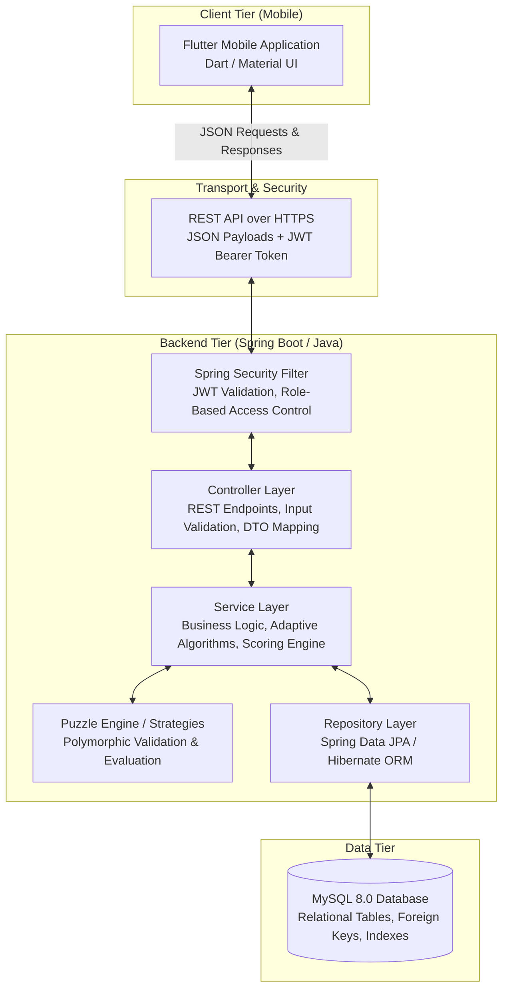
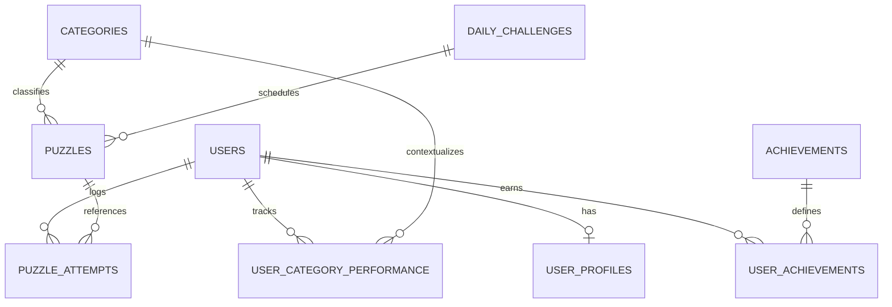
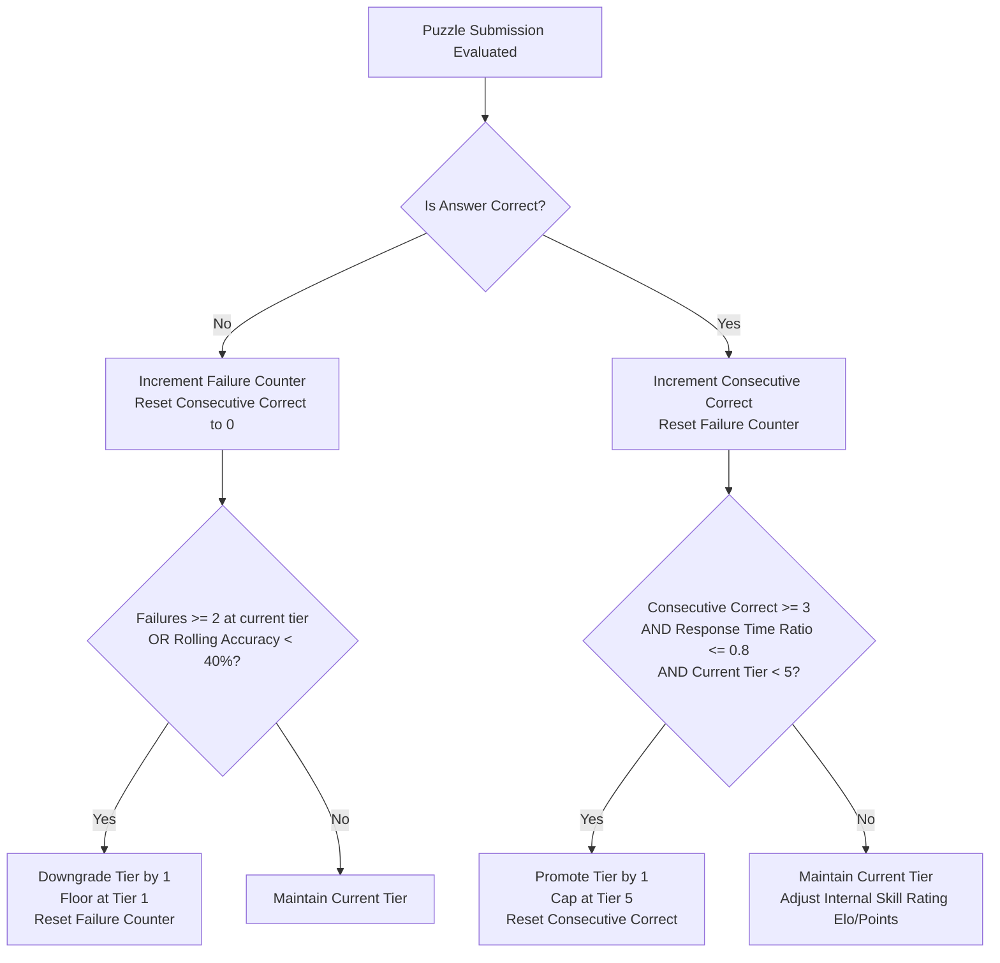
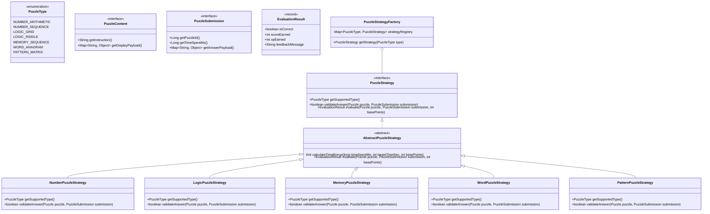

# MindMaze — Phase 0.1: Project Definition & Initial Planning

**Project Name:** MindMaze  
**Document Version:** 1.0  
**Phase:** 0.1 (Project Definition & Initial Planning)  
**Status:** Completed & Ready for Review  

---

## 1. Project Overview

### 1.1 Purpose
**MindMaze** is an adaptive, cognitive brain-training mobile application engineered to help users exercise, evaluate, and expand their cognitive faculties across multiple mental domains:
- **Numerical reasoning**
- **Logical deduction**
- **Working memory**
- **Verbal fluency**
- **Pattern recognition**

The primary engineering goal of MindMaze is to serve as a benchmark project showcasing **production-ready, idiomatic Java backend architecture** utilizing the Spring Boot ecosystem, backed by a modern, responsive cross-platform **Flutter** client. Rather than relying on Java solely as a passthrough CRUD persistence layer, MindMaze embeds rich, algorithmic domain logic into the backend service layers (e.g., dynamic difficulty adjustment, multi-metric scoring, strategy-based puzzle generation and validation, streak rules, and category analytics).

### 1.2 Main User Experience
1. **Onboarding & Registration:** The user registers or signs in using secure JWT-based credentials.
2. **Personalized Dashboard:** The home screen displays current level, XP progress, active streak count, daily challenge status, and category skill breakdown (cognitive radar).
3. **Adaptive Challenge Sessions:** The user selects a category (or launches the curated Daily Challenge). The Java backend selects or generates a puzzle matched to their current cognitive rating.
4. **Interactive Solving:** The user solves the puzzle inside a focused, timer-aware Flutter interface.
5. **Instant Evaluation & Feedback:** Upon submission, the backend evaluates the response, calculates accuracy and speed bonuses, updates skill ratings dynamically, logs the attempt, and returns immediate performance feedback.
6. **Progression & Analytics:** Users unlock achievements, maintain daily streaks, climb global/category levels, and review longitudinal analytics tracking cognitive growth over time.

---

## 2. Functional Requirements

### FR-1: User Account & Authentication
- **FR-1.1:** User registration with email, unique username, and secure password (minimum 8 characters).
- **FR-1.2:** User login issuing JSON Web Tokens (JWT) for stateless authentication.
- **FR-1.3:** Role-based access control distinguishing standard players (`ROLE_USER`) from administrators (`ROLE_ADMIN`).
- **FR-1.4:** User profile retrieval and updating (display name, avatar preferences).

### FR-2: Puzzle Categories & Solving
- **FR-2.1:** Support for 5 core cognitive categories:
  - *Number Puzzles* (mental math, arithmetic sequences, equation balances)
  - *Logic Puzzles* (deductive riddles, grid logic, truth/lie scenarios)
  - *Memory Puzzles* (sequence recall, visual grid memory, n-back challenges)
  - *Word Puzzles* (anagrams, word ladders, vocabulary associations)
  - *Pattern Puzzles* (matrix reasoning, visual transformations, symbol sequences)
- **FR-2.2:** Each puzzle belongs to a category and carries an intrinsic difficulty tier (Tiers 1 to 5: Novice, Apprentice, Adept, Master, Grandmaster).
- **FR-2.3:** Client requests a puzzle; backend provides puzzle payload (excluding solution data).
- **FR-2.4:** Client submits the answer alongside time spent; backend verifies accuracy and evaluates metrics.

### FR-3: Adaptive Difficulty Engine
- **FR-3.1:** Dynamically compute user's skill rating per category based on rolling performance.
- **FR-3.2:** Incrementally promote difficulty tier after consecutive accurate, fast solves.
- **FR-3.3:** Gracefully downgrade difficulty tier after repeated failures or excessive delays to prevent frustration.
- **FR-3.4:** Ensure puzzle selection serves challenges matching the user's current adaptive tier.

### FR-4: Scoring & Progression System
- **FR-4.1:** **Score Calculation:** Multi-variable formula incorporating base puzzle points, time-efficiency bonus, and accuracy multipliers.
- **FR-4.2:** **XP & Leveling:** Every completed attempt awards Experience Points (XP) governed by mathematical leveling curves.
- **FR-4.3:** **Streak System:** Maintain daily activity streaks; increment streak when at least one challenge is completed per calendar day; reset if a calendar day is missed.
- **FR-4.4:** **Achievement Engine:** Trigger milestone badges (e.g., "First Perfect Solve", "7-Day Streak", "Math Prodigy") evaluated automatically upon attempt completion.

### FR-5: Daily Challenge
- **FR-5.1:** Server produces a synchronized Daily Challenge set refreshed every 24 hours (UTC/local day window).
- **FR-5.2:** Completing the daily challenge grants bonus XP and protects/increments the user's streak.
- **FR-5.3:** Prevent duplicate rewards for replay within the same 24-hour cycle.

### FR-6: Analytics & Performance Tracking
- **FR-6.1:** Category-specific skill ratings and performance history (accuracy rate, average reaction time).
- **FR-6.2:** Longitudinal tracking (e.g., 7-day and 30-day cognitive trends).
- **FR-6.3:** Aggregated statistics (total puzzles solved, total time trained, current vs. highest streak).

### FR-7: Admin Puzzle Management
- **FR-7.1:** Admin capability to create, view, update, and soft-delete puzzle templates.
- **FR-7.2:** Validation of puzzle payload structures and verified solution formats before enabling a puzzle in rotation.

---

## 3. Non-Functional Requirements

| Metric / Dimension | Specification | Implementation Strategy |
| :--- | :--- | :--- |
| **Performance** | API response latency $\le 200\text{ ms}$ for puzzle verification and scoring under normal loads. | Optimized JPA queries, indexed database columns, lightweight stateless REST payloads. |
| **Security** | Secure authentication and data privacy; zero plain-text passwords. | BCrypt password hashing (work factor 12), stateless JWT with short expiry, strict CORS and Spring Security filters. |
| **Scalability** | Capable of supporting concurrent users solving challenges simultaneously. | Stateless Spring Boot instances, HikariCP database connection pooling, decoupled database schema design. |
| **Maintainability** | Clean separation of concerns and adherence to SOLID principles. | Controller-Service-Repository pattern, Strategy Pattern for puzzle validation/generation, DTO pattern separating entities from API contracts. |
| **Reliability** | Zero silent failures; consistent transactional state. | Global exception handling with RFC 7807 Problem Details, `@Transactional` boundaries on attempt evaluations, database foreign key constraints. |
| **Usability** | Frictionless, responsive mobile user interface with sub-100ms UI interactions. | Flutter state management (Bloc or Provider), offline resilience indicators, intuitive cognitive dashboard and timer components. |

---

## 4. User Roles & Responsibilities

### 4.1 Role: `USER` (Standard Player)
- **Permissions & Capabilities:**
  - Register, log in, and manage own profile.
  - Request puzzles by category or play the Daily Challenge.
  - Submit answers with timestamped attempt data.
  - View personal progression (XP, levels, streaks, badges).
  - Inspect personal category analytics and performance history.
- **Restrictions:**
  - Cannot inspect puzzle solution payloads directly.
  - Cannot access other users' private metrics or credentials.
  - Cannot access administrative APIs.

### 4.2 Role: `ADMIN` (Content & System Manager)
- **Permissions & Capabilities:**
  - Inherits all `USER` access capabilities for testing purposes.
  - Create, edit, activate, deactivate, or delete puzzle records.
  - Monitor aggregate system metrics (total registered users, total attempts, category solve rates).
  - Trigger manual streak recalculations or diagnostic audits if needed.
- **Restrictions:**
  - Cannot view plain-text user passwords (hashed via BCrypt).

---

## 5. Core System Modules

```
MindMaze Backend
├── 1. Authentication & Security Module (JWT, UserDetails, SecurityFilterChain)
├── 2. User & Profile Module (Account info, preferences, profile stats)
├── 3. Puzzle Management Module (Catalog, Admin CRUD, Category indexing)
├── 4. Puzzle Engine Module (Polymorphic generators, validators, parsers)
├── 5. Attempt & Evaluation Module (Submission processing, verification flow)
├── 6. Scoring & Progression Module (Points formula, XP curves, Level thresholds)
├── 7. Adaptive Difficulty Engine (Performance evaluation, rating calculations)
├── 8. Streak Management Module (Timezone-aware day boundaries, streak updates)
├── 9. Achievement Module (Criteria evaluation, badge issuance)
├── 10. Daily Challenge Module (Daily puzzle schedule, completion guards)
├── 11. Analytics Module (Aggregate statistics, category breakdowns, radar charts)
└── 12. Administration Module (System maintenance, content curation)
```

---

## 6. High-Level Architecture

### 6.1 Architectural Topology
MindMaze adopts a decoupled, multi-tier client-server architecture:



### 6.2 Layer Responsibilities

1. **Flutter Mobile App:**
   - Handles presentation, animations, timers, and client-side input capture.
   - Manages local token storage securely (`flutter_secure_storage`).
   - Renders puzzle views dynamically based on the category and puzzle type.
   - Never determines score, correct answer, or difficulty shifts locally.

2. **REST API / Transport Layer:**
   - Standard HTTP verbs (`GET`, `POST`, `PUT`, `DELETE`).
   - Stateless communication via JSON payloads.
   - Secured with Bearer JWT tokens in the `Authorization` header.

3. **Spring Boot Controller Layer (`@RestController`):**
   - Exposes clean, versioned endpoints (`/api/v1/...`).
   - Enforces bean validation via `@Valid` and Jakarta validation annotations (`@NotNull`, `@NotBlank`, etc.).
   - Converts HTTP requests into Service calls and transforms internal models into response DTOs.

4. **Service Layer (`@Service`):**
   - **Heart of MindMaze Java logic.** Contains all business and algorithmic intelligence.
   - Executes puzzle validation, calculates multi-metric scores, updates XP curves, checks streaks, evaluates achievements, and invokes the adaptive difficulty engine.
   - Enforces transaction boundaries (`@Transactional`) to maintain ACID properties.

5. **Puzzle Engine & Strategies:**
   - Domain-specific strategies implementing common Java interfaces.
   - Encapsulates how different puzzle types (math, logic, anagrams, sequences) validate submissions and compute granular hints/metrics.

6. **Repository Layer (`@Repository`):**
   - Built on Spring Data JPA interfaces extending `JpaRepository`.
   - Uses optimized JPQL / derived queries and projection DTOs where appropriate.

7. **MySQL Database:**
   - Persists all relational entities with strict referential integrity (foreign keys, cascading rules, unique indexes).

---

## 7. Major Data Entities

*Note: Conceptual design only. No database or migration scripts are executed in this phase.*



### 7.1 Entity Specifications

#### 1. `User`
- **Purpose:** Represents the core authentication and identity account.
- **Key Fields:** `id` (UUID or Long PK), `username` (unique), `email` (unique), `passwordHash` (BCrypt string), `role` (`ROLE_USER`, `ROLE_ADMIN`), `isActive` (boolean), `createdAt` (timestamp).
- **Relationships:** One-to-One with `UserProfile`; One-to-Many with `PuzzleAttempt`, `UserCategoryPerformance`, and `UserAchievement`.

#### 2. `UserProfile`
- **Purpose:** Tracks global progression metrics for a specific user.
- **Key Fields:** `id` (PK), `userId` (FK to User), `totalXp` (Long), `currentLevel` (Integer), `currentStreak` (Integer), `longestStreak` (Integer), `lastActiveDate` (LocalDate), `puzzlesSolved` (Integer).
- **Relationships:** One-to-One with `User`.

#### 3. `Category`
- **Purpose:** Categorizes cognitive puzzle domains.
- **Key Fields:** `id` (PK), `code` (e.g., `NUMBER`, `LOGIC`, `MEMORY`, `WORD`, `PATTERN`), `displayName` (string), `description` (text), `iconName` (string).
- **Relationships:** One-to-Many with `Puzzle`; One-to-Many with `UserCategoryPerformance`.

#### 4. `Puzzle`
- **Purpose:** Represents an individual puzzle or template in the catalog.
- **Key Fields:** `id` (PK), `categoryId` (FK to Category), `difficultyTier` (1-5), `title` (string), `instruction` (string), `puzzleDataJson` (JSON text containing challenge parameters, e.g., grid state, sequence numbers, clues), `solutionDataJson` (JSON text containing expected answers / verification rules), `targetTimeSeconds` (Integer), `basePoints` (Integer), `isActive` (Boolean), `createdAt` (Timestamp).
- **Relationships:** Many-to-One with `Category`; One-to-Many with `PuzzleAttempt`.

#### 5. `PuzzleAttempt`
- **Purpose:** Immutable audit record of every puzzle challenge played by a user.
- **Key Fields:** `id` (PK), `userId` (FK to User), `puzzleId` (FK to Puzzle), `isCorrect` (Boolean), `timeSpentMs` (Long), `scoreEarned` (Integer), `xpEarned` (Integer), `userSubmissionJson` (JSON text of user's answer), `attemptedAt` (Timestamp).
- **Relationships:** Many-to-One with `User`; Many-to-One with `Puzzle`.

#### 6. `UserCategoryPerformance`
- **Purpose:** Tracks longitudinal skill rating and performance history per user per category.
- **Key Fields:** `id` (PK), `userId` (FK to User), `categoryId` (FK to Category), `currentRating` (Double or Integer, e.g., 1000-2500 rating scale or Tier 1-5), `consecutiveCorrect` (Integer), `totalAttempts` (Integer), `totalCorrect` (Integer), `averageTimeMs` (Long), `lastAttemptedAt` (Timestamp).
- **Relationships:** Many-to-One with `User`; Many-to-One with `Category`; Unique constraint on `(userId, categoryId)`.

#### 7. `Achievement`
- **Purpose:** Catalog of unlockable milestones and cognitive trophies.
- **Key Fields:** `id` (PK), `code` (unique string, e.g., `STREAK_7`, `MATH_WIZARD_10`), `title` (string), `description` (string), `badgeIconUrl` (string), `criteriaType` (string), `criteriaThreshold` (Integer).
- **Relationships:** One-to-Many with `UserAchievement`.

#### 8. `UserAchievement`
- **Purpose:** Join entity tracking which achievements a user has earned.
- **Key Fields:** `id` (PK), `userId` (FK to User), `achievementId` (FK to Achievement), `unlockedAt` (Timestamp).
- **Relationships:** Many-to-One with `User`; Many-to-One with `Achievement`; Unique constraint on `(userId, achievementId)`.

#### 9. `DailyChallenge`
- **Purpose:** Manages the scheduled daily challenge for all users.
- **Key Fields:** `id` (PK), `challengeDate` (LocalDate, unique), `puzzleId` (FK to Puzzle), `bonusXpMultiplier` (Double), `createdAt` (Timestamp).
- **Relationships:** Many-to-One with `Puzzle`.

---

## 8. Adaptive Difficulty Concept

### 8.1 Conceptual Objective
To prevent boredom from challenges that are too easy and frustration from challenges that are too difficult, MindMaze maintains an **Adaptive Difficulty Engine** for each cognitive category.

### 8.2 Evaluation Factors
The adaptive engine evaluates six primary inputs upon every puzzle submission:
1. **Accuracy (`isCorrect`):** Fundamental binary result (true/false).
2. **Response Time vs. Target Time Ratio ($R_t$):**
   $$R_t = \frac{\text{timeSpentMs}}{\text{targetTimeSeconds} \times 1000}$$
   - $R_t \le 0.6$: Very fast solve (indicates mastery of current tier).
   - $0.6 < R_t \le 1.0$: Optimal solving pace.
   - $R_t > 1.0$: Slow solve (user struggled or was under pressure).
3. **Current Category Tier:** Tiers 1 through 5 (Novice, Apprentice, Adept, Master, Grandmaster).
4. **Consecutive Correct Counter:** Tracks current uninterrupted winning streak within that category.
5. **Rolling Accuracy (Last $N$ attempts):** Evaluates performance over a moving window of the last 5 to 10 attempts.
6. **Error Pattern / Failure Count:** Tracks repeated failed attempts at the current tier.

### 8.3 Conceptual Adaptation Rules



### 8.4 Interview-Friendly Value of This Design
- Demonstrates how business domain logic belongs in **Java Service classes** (`AdaptiveDifficultyService`) rather than stored procedures or frontend clients.
- Clean mathematical modeling using pure Java classes, enabling straightforward JUnit unit testing with edge cases (boundary testing at Tier 1 and Tier 5).

---

## 9. Puzzle Architecture

### 9.1 Design Goals
1. **Extensibility (Open/Closed Principle):** Adding a new puzzle category or variant must not require modifying the existing core evaluation loop.
2. **Polymorphic Validation:** Every puzzle type knows how to parse, validate, and score its own unique payload format.
3. **Decoupled Client Contracts:** The client receives only what is needed to render the puzzle (`puzzleDataJson`), while sensitive solution logic (`solutionDataJson`) remains securely encapsulated on the backend.

### 9.2 Class & Interface Hierarchy



### 9.3 Extensibility Walkthrough
- When a user submits an answer, `AttemptService` queries `PuzzleStrategyFactory` with the puzzle's `PuzzleType`.
- The factory returns the registered Spring bean implementing `PuzzleStrategy`.
- The strategy parses the submission JSON and solution JSON, performs type-specific comparisons (e.g., set equality, sequential order, string normalization), and computes scoring bonuses.
- **Adding a new puzzle type in the future requires only:**
  1. Adding a new constant to `PuzzleType`.
  2. Creating a new `@Component` class extending `AbstractPuzzleStrategy`.
  3. Spring Boot automatically injects all strategies into `PuzzleStrategyFactory` via constructor dependency injection (`List<PuzzleStrategy>`).

---

## 10. REST API Planning

All endpoints will be versioned under `/api/v1/`.

### 10.1 Authentication & Profile (`/api/v1/auth`, `/api/v1/users`)
- `POST /api/v1/auth/register` — Create new user account.
- `POST /api/v1/auth/login` — Authenticate credentials; return JWT and user summary.
- `POST /api/v1/auth/refresh` — Refresh expired access token using refresh token.
- `GET /api/v1/users/me` — Fetch current user's profile and progress summary.
- `PUT /api/v1/users/me` — Update display preferences.

### 10.2 Puzzle Operations (`/api/v1/puzzles`)
- `GET /api/v1/puzzles/categories` — List all active cognitive categories.
- `GET /api/v1/puzzles/next?categoryId={id}` — Request an adaptive puzzle for the authenticated user based on their current category tier.
- `GET /api/v1/puzzles/{id}` — Fetch specific puzzle metadata and client payload (no solution data).
- `POST /api/v1/puzzles/{id}/attempts` — Submit answer, time spent, and receive immediate evaluation result.

### 10.3 Daily Challenge (`/api/v1/daily-challenge`)
- `GET /api/v1/daily-challenge/today` — Retrieve today's global challenge puzzle and status (completed or pending).
- `POST /api/v1/daily-challenge/today/attempt` — Submit solution for today's daily challenge.

### 10.4 Progression & Analytics (`/api/v1/progress`, `/api/v1/analytics`)
- `GET /api/v1/progress/summary` — Level, total XP, current streak, longest streak.
- `GET /api/v1/progress/achievements` — List all achievements with user unlock status.
- `GET /api/v1/analytics/radar` — Category-wise skill ratings (normalized for radar chart rendering).
- `GET /api/v1/analytics/history?days=30` — Daily activity and accuracy trends over time.

### 10.5 Administration (`/api/v1/admin`) — *Requires `ROLE_ADMIN`*
- `GET /api/v1/admin/puzzles` — Paginated list of all puzzles across tiers and statuses.
- `POST /api/v1/admin/puzzles` — Create a new puzzle template with solution rules.
- `PUT /api/v1/admin/puzzles/{id}` — Update puzzle content or difficulty parameters.
- `PATCH /api/v1/admin/puzzles/{id}/status` — Enable or disable a puzzle from rotation.
- `GET /api/v1/admin/analytics/overview` — System-wide aggregate usage statistics.

---

## 11. Complete Development Roadmap (Phases 0 - 17)


### Phase Details

* **Phase 0 — Foundation & Planning:**
  Establish vision, architecture, non-functional requirements, entity models, and phase roadmap. *(Current Phase)*
* **Phase 1 — Core Java Domain & Algorithms:**
  Implement pure Java data models, puzzle interfaces, scoring algorithms, and unit tests without web framework dependencies.
* **Phase 2 — Spring Boot Architecture Setup:**
  Initialize Maven Spring Boot project, define layered structure (controller, service, repository, exception handlers), and configure application profiles.
* **Phase 3 — MySQL Database & Spring Data JPA:**
  Design schema migrations, map JPA entities with relationships, establish repositories, and verify database integration.
* **Phase 4 — Authentication & Spring Security:**
  Implement user registration, BCrypt password hashing, JWT generation/validation, Spring Security filter chain, and role-based guards.
* **Phase 5 — Puzzle Engine Implementation:**
  Build out the `PuzzleStrategy` hierarchy, strategy factory, puzzle generation/parsing logic, and answer validation routines.
* **Phase 6 — Adaptive Difficulty Engine:**
  Implement dynamic rating algorithms, tier adjustment logic, moving average performance trackers, and test with varied simulation profiles.
* **Phase 7 — Scoring, XP, Streaks & Progression:**
  Implement multi-variable scoring calculation, XP leveling curve, timezone-aware daily streak manager, and achievement evaluation listener.
* **Phase 8 — Daily Challenge Service:**
  Build daily challenge scheduling, completion verification, and bonus multiplier logic.
* **Phase 9 — Flutter Mobile App Foundation:**
  Initialize Flutter application, establish clean folder structure, theme design system, typography, and core navigation.
* **Phase 10 — API Integration & Mobile Puzzle Play:**
  Integrate Flutter HTTP client with Spring Boot backend, manage secure JWT storage, and build interactive gameplay screens for each category.
* **Phase 11 — Analytics & Visualizations:**
  Create backend aggregation endpoints; render radar charts, progress graphs, and cognitive breakdown visuals in Flutter.
* **Phase 12 — Admin Management Features:**
  Build administrative endpoints and interface for puzzle management and system inspection.
* **Phase 13 — Comprehensive Testing & Quality Assurance:**
  Implement JUnit 5 unit tests, Mockito service mocks, MockMvc controller integration tests, and Postman API test collections.
* **Phase 14 — UI/UX Polish & Feedback:**
  Refine mobile animations, sound feedback/haptics, error states, loading skeletons, and edge-case handling.
* **Phase 15 — Production Build & Deployment:**
  Containerize backend with Docker, configure production MySQL instance, build signed Android APK/bundle, and prepare environment configurations.
* **Phase 16 — GitHub Repository & Documentation:**
  Assemble professional README with architecture diagrams, API documentation, setup instructions, and clean Git commit history.
* **Phase 17 — Resume & Interview Preparation:**
  Formulate architectural defense talking points, Java design pattern explanations, concurrency/scaling answers, and portfolio demo guides.

---

## 12. Phase 0.1 Completion Criteria Checklist

- [x] **Project Overview:** Clear definition of MindMaze's purpose and end-to-end user experience documented.
- [x] **Functional Requirements:** Comprehensive list of functional requirements organized by capability area.
- [x] **Non-Functional Requirements:** Specific, measurable specifications for performance, security, scalability, maintainability, reliability, and usability.
- [x] **User Roles:** Clear role definitions and privilege boundaries established for `USER` and `ADMIN`.
- [x] **Core Modules:** High-level logical decomposition into 12 distinct system modules.
- [x] **High-Level Architecture:** Multi-tier architectural flow mapped from Flutter to MySQL with explicit layer responsibilities.
- [x] **Major Data Entities:** Conceptual relational entity models, fields, and relationships defined without creating unapproved tables.
- [x] **Adaptive Difficulty Concept:** Clear mathematical and algorithmic rules formulated for dynamic tier adjustment based on performance metrics.
- [x] **Puzzle Architecture:** Extensible Object-Oriented design utilizing interfaces, abstract classes, strategy patterns, and factories.
- [x] **API Planning:** Major REST endpoint groups mapped under `/api/v1/`.
- [x] **Development Roadmap:** Full 18-phase progression (Phases 0 through 17) explicitly mapped.
- [x] **Strict Constraints Respected:** Zero application code generated; Java established as primary backend language; no assumptions outside approved scope.

---
*End of Phase 0.1 Planning Document.*
