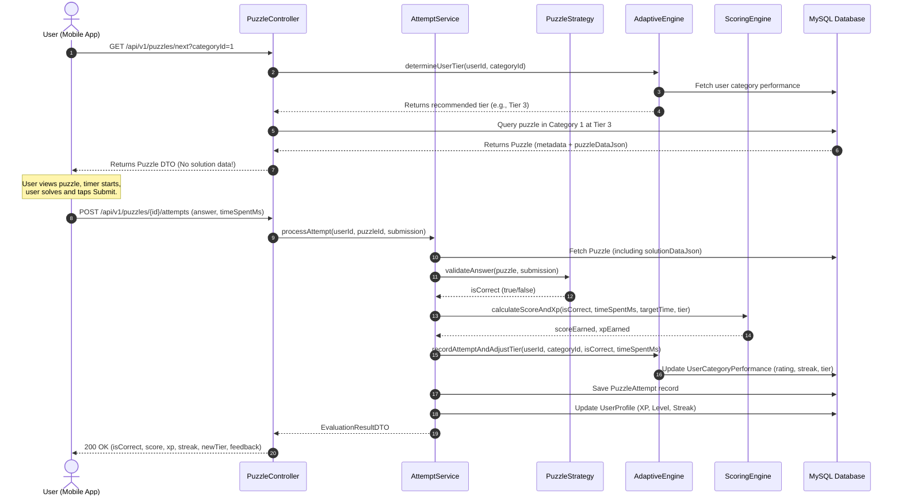
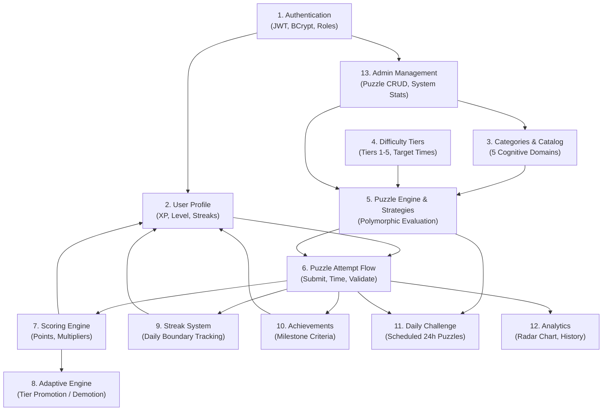

# MindMaze — Detailed Feature Specification v0.1

**Document Version:** 0.1  
**Phase:** 0.2 (Detailed Feature Specification)  
**Status:** Completed & Ready for Review  
**Architecture Style:** Modular Monolith (Spring Boot Backend + Flutter Mobile Client)  

---

## 1. Authentication

### 1.1 Overview
The Authentication module provides secure account creation, identity verification, session management, and role-based access control (`ROLE_USER`, `ROLE_ADMIN`) using JSON Web Tokens (JWT) and BCrypt password hashing.

### 1.2 Who Can Use It
- Anonymous users (for Registration, Login)
- Authenticated users (for Logout, Token Refresh, Identity Verification)

### 1.3 User Flow
1. **Registration:**
   - User inputs email, username, and password.
   - Flutter client performs initial format validation.
   - Client sends `POST /api/v1/auth/register`.
   - Backend checks uniqueness, hashes password, initializes user record and associated profile, and returns HTTP 201 Created with a success status or auto-login JWT.
2. **Login:**
   - User enters identifier (email or username) and password.
   - Client sends `POST /api/v1/auth/login`.
   - Backend verifies credentials against BCrypt hash, creates a signed JWT access token (and optional refresh token), and returns user summary with token.
   - Client saves token in secure storage (`flutter_secure_storage`).
3. **Authenticated Requests:**
   - Client includes `Authorization: Bearer <token>` on all private API calls.
   - Backend `JwtAuthenticationFilter` validates token signature, expiration, and extracts claims (`userId`, `role`).
4. **Logout:**
   - Client deletes local token from secure storage.
   - Client calls `POST /api/v1/auth/logout` (backend can log event or add token to a short-lived memory blacklist if token invalidation before expiry is required).

### 1.4 Layer Responsibilities
- **Backend:** Password hashing (BCrypt work factor 12), JWT generation and cryptographic verification, role assignment, duplicate account validation, stateless security filter chain.
- **Mobile:** Secure local storage of tokens, attaching Bearer token to HTTP interceptor headers, managing session expiration (clearing state and routing to login upon HTTP 401).

### 1.5 Data Required
- `username` (string, unique, alphanumeric + underscores, 3-20 characters)
- `email` (string, unique, valid email format)
- `password` (string, minimum 8 characters, at least 1 digit and 1 letter)

### 1.6 Expected Input & Output Contracts
- **Input (`POST /api/v1/auth/register`):**
  ```json
  {
    "username": "brain_master",
    "email": "user@example.com",
    "password": "SecurePassword123"
  }
  ```
- **Output (`201 Created`):**
  ```json
  {
    "userId": 1,
    "username": "brain_master",
    "email": "user@example.com",
    "role": "ROLE_USER",
    "token": "eyJhbGciOiJIUzI1NiIs...",
    "expiresIn": 86400
  }
  ```
- **Input (`POST /api/v1/auth/login`):**
  ```json
  {
    "usernameOrEmail": "brain_master",
    "password": "SecurePassword123"
  }
  ```
- **Output (`200 OK`):**
  ```json
  {
    "userId": 1,
    "username": "brain_master",
    "role": "ROLE_USER",
    "token": "eyJhbGciOiJIUzI1NiIs...",
    "expiresIn": 86400
  }
  ```

### 1.7 Important Validation Rules
- Password must be $\ge 8$ characters, containing at least one digit and one alphabetic character.
- Email must conform to RFC 5322 regex.
- Username must contain only `[a-zA-Z0-9_]` and be 3–20 characters.
- Duplicate email or username returns `409 Conflict` with a user-friendly error message.

### 1.8 Edge Cases
- **Invalid Credentials:** Return generic `401 Unauthorized` ("Invalid username or password") to prevent account enumeration.
- **Token Expiration:** Expired token returns `401 Unauthorized` with `Token-Expired` code, prompting mobile client to redirect to login.
- **Unauthorized Role Access:** Regular user accessing `/api/v1/admin/*` returns `403 Forbidden`.
- **Account Inactive/Locked:** If `isActive == false`, login returns `403 Forbidden` ("Account deactivated").

### 1.9 Dependencies on Other Features
- Foundation for all user-specific features (Profiles, Attempts, Streaks, Analytics, Admin).

---

## 2. User Profile

### 2.1 Overview
The User Profile feature maintains personal display attributes, account preferences, and high-level progress aggregates (total XP, current level, current streak, longest streak).

### 2.2 Who Can Use It
- Authenticated user (view/update own profile)
- Admin (view user profile metadata)

### 2.3 User Flow
1. User opens the application or navigates to the Profile tab.
2. Mobile client requests `GET /api/v1/users/me` with Bearer token.
3. Backend fetches `User` and linked `UserProfile`, returning combined profile metrics.
4. User updates their display name or preferred theme/notifications and clicks "Save".
5. Client sends `PUT /api/v1/users/me`. Backend updates fields and returns updated profile.

### 2.4 Layer Responsibilities
- **Backend:** Ensure transactional creation of `UserProfile` upon user registration; maintain aggregate progression counters; expose safe DTOs without exposing password hashes.
- **Mobile:** Cache profile locally for instant UI rendering; format level progress bars and streak icons.

### 2.5 Data Required
- `displayName` (string, max 30 chars, optional)
- `totalXp` (long, default 0)
- `currentLevel` (int, default 1)
- `currentStreak` (int, default 0)
- `longestStreak` (int, default 0)
- `lastActiveDate` (date)

### 2.6 Expected Input & Output Contracts
- **Output (`GET /api/v1/users/me`):**
  ```json
  {
    "userId": 1,
    "username": "brain_master",
    "displayName": "Alex M.",
    "email": "user@example.com",
    "totalXp": 1450,
    "currentLevel": 4,
    "xpToNextLevel": 550,
    "currentStreak": 5,
    "longestStreak": 12,
    "joinedDate": "2026-09-01"
  }
  ```

### 2.7 Validation & Edge Cases
- Display name cannot be blank or exceed 30 characters.
- Non-existent user returns `404 Not Found`.

### 2.8 Dependencies on Other Features
- Depends on: **Authentication**
- Informs: **Progress & Analytics**, **Dashboard**

---

## 3. Puzzle Categories

MindMaze organizes cognitive challenges into 5 foundational categories. Each category tests distinct neural processes and requires tailored input and verification logic.

### 3.1 Category Breakdown

| Category | Cognitive Domain | Example Challenge Types | Input / UI Interaction Format | Answer / Verification Format |
| :--- | :--- | :--- | :--- | :--- |
| **NUMBER** | Mental arithmetic, quantitative reasoning, sequence extrapolation | Missing sequence number ($3, 7, 15, 31, ?$); balancing arithmetic equations ($14 + ? \times 3 = 35$) | Numeric keypad or 4 multiple-choice options | Single integer or numeric string; direct equality verification |
| **LOGIC** | Deductive reasoning, condition evaluation, syllogisms | Truth/Lie deductions ("Person A says...", grid deduction riddles) | Multiple-choice option selection or boolean true/false toggle | String identifier of the chosen option; matched against correct option key |
| **MEMORY** | Working memory, spatial recall, sequence replication | Visual grid pattern flash (remember lit tiles for 3s, then tap them); digit span recall | Matrix tap grid ($3 \times 3$ or $4 \times 4$) or sequential key taps | Array of coordinate indices or sequence array; evaluated for exact ordered/unordered match |
| **WORD** | Verbal fluency, lexical retrieval, anagram resolution | Anagram unscrambling ("L E P A P" $\rightarrow$ "APPLE"); word ladder / word association | Letter tile bank tapping or text input | Canonical lowercase word string; exact string or accepted synonym match |
| **PATTERN** | Abstract reasoning, visual matrix completion, spatial rotation | Matrix reasoning ($2 \times 2$ or $3 \times 3$ visual matrix missing 1 cell); sequence orientation | 4 visual tile choices ($A, B, C, D$) | Option index / key; matched against target symbol ID |

### 3.2 Category Progression Strategy
- **Tiers 1–2:** Direct, single-step operations with generous time limits (e.g., 3-item sequences, 4-letter anagrams, 3-tile memory grids).
- **Tier 3:** Multi-step operations or compound clues (e.g., 2-operator math, 6-letter anagrams, 5-tile memory grids).
- **Tiers 4–5:** Complex constraint satisfaction, distractor clues, short presentation times (e.g., geometric sequence combinations, 8-tile memory grids with distractors).

### 3.3 Backend vs Mobile Responsibility
- **Backend:** Encapsulates puzzle payload definition (instructions, clues, layout variables) and verifies submissions via polymorphic `PuzzleStrategy` beans. The backend *never* exposes `solutionDataJson` to the client.
- **Mobile:** Renders category-specific interactive controls (keypad, grid, tile bank, selector buttons) and handles animation transitions.

---

## 4. Puzzle Difficulty

### 4.1 Difficulty Levels (Tiers 1 to 5)
1. **Tier 1 (Novice):** Warm-up complexity. Minimal mental steps ($1$ step), generous target time ($30\text{--}45\text{s}$), zero distractors.
2. **Tier 2 (Apprentice):** Basic complexity. Straightforward rules, standard target time ($25\text{--}35\text{s}$).
3. **Tier 3 (Adept):** Intermediate complexity. Requires combining 2 mental steps or maintaining 5 items in working memory ($20\text{--}30\text{s}$).
4. **Tier 4 (Master):** Advanced complexity. Multi-variable constraints, non-linear logic, tighter time limits ($15\text{--}25\text{s}$).
5. **Tier 5 (Grandmaster):** Expert complexity. High cognitive load, subtle pattern shifts, tight target time ($10\text{--}20\text{s}$).

### 4.2 What Makes a Puzzle Harder?
- **Arithmetic:** Number magnitude, negative numbers, multiple operations, order of precedence.
- **Memory:** Number of elements, display duration before hiding, grid dimensions ($3 \times 3 \rightarrow 4 \times 4 \rightarrow 5 \times 5$).
- **Logic:** Number of active constraints, negative assertions ("neither X nor Y"), multi-entity relationships.
- **Word:** Word length, rarity of vocabulary, number of anagram permutations.
- **Pattern:** Number of simultaneous transformation rules (e.g., rotation + color inversion + shape count).

### 4.3 Storage & API Representation
- **In Database:** Stored as integer column `difficulty_tier` ($1 \le \text{tier} \le 5$) on `puzzles` table.
- **In API:** Exposed in puzzle response DTO as `"difficultyTier": 3` along with `"targetTimeSeconds": 25`.

---

## 5. Puzzle Attempt Lifecycle

The complete execution lifecycle for solving a puzzle:



### Lifecycle Step Specifications
1. **Request Challenge:** Mobile calls `GET /api/v1/puzzles/next?categoryId={id}` with JWT.
2. **Receive Puzzle:** Backend selects puzzle matching user's category tier. Payload contains title, instruction, target time, and `puzzleDataJson`.
3. **Start Challenge:** Mobile records start timestamp and starts visible countdown/stopwatch.
4. **Submit Answer:** Mobile captures user's answer payload and elapsed milliseconds (`timeSpentMs`), sending `POST /api/v1/puzzles/{id}/attempts`.
5. **Evaluate:** Backend locates `PuzzleStrategy` for puzzle type and compares answer against `solutionDataJson`.
6. **Calculate Time:** Backend verifies `timeSpentMs` is plausible ($\ge 500\text{ ms}$, $\le 300{,}000\text{ ms}$).
7. **Calculate Score & XP:** Invokes Scoring Engine to determine points based on correctness, time bonus, and difficulty tier.
8. **Update Performance:** Persists attempt in `puzzle_attempts` table.
9. **Update Adaptive Difficulty:** Feeds accuracy and speed into `AdaptiveDifficultyService` to adjust rolling stats and tier counters.
10. **Return Result:** Client receives evaluation response and renders celebration/retry feedback.

---

## 6. Scoring System (Design Proposal)

### 6.1 Formula Components
- **Base Points ($P_{\text{base}}$):** Assigned based on difficulty tier:
  - Tier 1: $100\text{ pts}$
  - Tier 2: $150\text{ pts}$
  - Tier 3: $220\text{ pts}$
  - Tier 4: $300\text{ pts}$
  - Tier 5: $400\text{ pts}$
- **Time Bonus Multiplier ($M_{\text{time}}$):**
  If answer is incorrect: $M_{\text{time}} = 0$.  
  If answer is correct, let $t = \text{timeSpentMs} / 1000$ and $T = \text{targetTimeSeconds}$:
  - If $t \le 0.5 \times T$: $M_{\text{time}} = 0.50$ ($+50\%$ bonus for exceptional speed)
  - If $0.5 \times T < t \le T$: $M_{\text{time}} = \frac{T - t}{T} \times 0.50$ (linear bonus scaling from $50\%$ down to $0\%$)
  - If $t > T$: $M_{\text{time}} = 0$ (no time bonus, but base points retained)
- **Streak Multiplier ($M_{\text{streak}}$):**
  - Consecutive correct answers in session:
    - 1–2 in a row: $1.0\times$
    - 3–4 in a row: $1.1\times$ ($+10\%$)
    - 5+ in a row: $1.25\times$ ($+25\%$)

### 6.2 Proposed Total Score Equation
$$\text{Total Score} = \begin{cases} 
0, & \text{if incorrect} \\
\lfloor P_{\text{base}} \times (1 + M_{\text{time}}) \times M_{\text{streak}} \rfloor, & \text{if correct}
\end{cases}$$

*(Status: Design proposal. Formula constants can be calibrated during testing.)*

---

## 7. Adaptive Difficulty

### 7.1 Functional Behavior
The Adaptive Difficulty engine runs per user per category to ensure difficulty dynamically tracks individual capability.

```
High Accuracy & Fast Speed  -->  Promote Tier (max Tier 5)
Consistent Steady Solves    -->  Maintain Tier
Repeated Mistakes / Slow   -->  Demote Tier (min Tier 1)
```

### 7.2 Rules & Metrics Considered
1. **Rolling Performance Window:** The last $5$ attempts in that specific category.
2. **Consecutive Correct Counter:**
   - If user achieves $3$ consecutive correct answers at Tier $K$ ($K < 5$) with average response time $\le 90\%$ of target time:
     $\rightarrow$ **Promote to Tier $K + 1$**; reset consecutive counter to $0$.
3. **Failure Threshold:**
   - If user fails $2$ consecutive attempts at Tier $K$ ($K > 1$) OR rolling accuracy drops below $40\%$:
     $\rightarrow$ **Demote to Tier $K - 1$**; reset failure counter.
4. **Boundary Limits:**
   - Minimum tier: $1$ (Novice)
   - Maximum tier: $5$ (Grandmaster)

### 7.3 New User & Cold-Start Behavior
- Brand-new users start at **Tier 1** in all categories.
- During the first $3$ attempts in a category (insufficient history), a single mistake does *not* demote (grace period); promotions occur quickly (2 fast correct answers elevate to Tier 2).

---

## 8. XP & Level Progression

### 8.1 XP Earning Rules
Experience points (XP) measure long-term cognitive effort and are awarded on every attempt:
- **Correct Solve Base XP:**
  - Tier 1: $20\text{ XP}$
  - Tier 2: $30\text{ XP}$
  - Tier 3: $45\text{ XP}$
  - Tier 4: $65\text{ XP}$
  - Tier 5: $90\text{ XP}$
- **Effort XP for Incorrect Attempt:** $5\text{ XP}$ (awarded to encourage persistence, provided time spent was $\ge 5\text{ seconds}$).
- **Daily Challenge Completion Bonus:** $+50\text{ Bonus XP}$.
- **Daily Streak Bonus:** $+5\text{ XP} \times \min(\text{streakDays}, 10)$ (up to $+50\text{ XP}$ daily).

### 8.2 Proposed Level Progression Table
A quadratic progression curve ensures early levels feel rewarding while higher levels require dedication:
$$\text{XP Required for Level } L = 100 \times L^2 - 100 \times L$$

| Level | Title | Total Cumulative XP Required | XP Needed from Previous Level |
| :---: | :--- | :---: | :---: |
| **1** | Novice Thinker | $0\text{ XP}$ | — |
| **2** | Curious Seeker | $200\text{ XP}$ | $200\text{ XP}$ |
| **3** | Pattern Apprentice | $600\text{ XP}$ | $400\text{ XP}$ |
| **4** | Logical Solver | $1{,}200\text{ XP}$ | $600\text{ XP}$ |
| **5** | Memory Adept | $2{,}000\text{ XP}$ | $800\text{ XP}$ |
| **6** | Sharp Strategist | $3{,}000\text{ XP}$ | $1{,}000\text{ XP}$ |
| **7** | Cognitive Master | $4{,}200\text{ XP}$ | $1{,}200\text{ XP}$ |
| **8** | Mind Architect | $5{,}600\text{ XP}$ | $1{,}400\text{ XP}$ |
| **9** | Grandmaster | $7{,}200\text{ XP}$ | $1{,}600\text{ XP}$ |
| **10** | Maze Sovereign | $9{,}000\text{ XP}$ | $1{,}800\text{ XP}$ |

### 8.3 Level-Up Behavior
- When an attempt's awarded XP pushes `totalXp` past the threshold for `currentLevel + 1`, the backend increments `currentLevel` and returns `"leveledUp": true` with new level details in the response DTO.
- Mobile client displays a level-up celebratory modal/animation.

---

## 9. Streak System

### 9.1 Functional Rules
1. **Daily Completion:** A streak day is credited when the user completes at least **one puzzle attempt** (normal puzzle or daily challenge) during a calendar day.
2. **Current Streak:**
   - If user solves a puzzle today (calendar day $D$):
     - If user last solved on day $D - 1$: `currentStreak = currentStreak + 1`.
     - If user last solved on day $D$: streak count remains unchanged (already credited today).
     - If user last solved before day $D - 1$: streak resets to $1$.
3. **Longest Streak:** If `currentStreak > longestStreak`, update `longestStreak = currentStreak`.
4. **Multiple Attempts in One Day:** Multiple attempts on the same calendar day reward standard XP and score, but do not increment streak count more than once per day.
5. **Time-Zone Handling:**
   - Server records all timestamps in UTC (`Instant`).
   - For calendar day boundary checks, client provides user's local timezone offset or IANA timezone (e.g., `Asia/Kolkata` or `UTC+05:30`) via header `X-User-Timezone` or profile setting.
   - The backend computes calendar dates relative to the user's localized date.

---

## 10. Achievements Catalog (Initial Set)

MindMaze features 12 core achievements evaluated by the backend upon attempt completion:

| # | Code | Name | Category | Requirement / Trigger | Reward |
| :-: | :--- | :--- | :--- | :--- | :-: |
| 1 | `FIRST_STEP` | First Step | Onboarding | Complete your first puzzle attempt | $+20\text{ XP}$ |
| 2 | `PERFECT_START` | Flawless Mind | Precision | Solve a puzzle with 100% accuracy on first try | $+30\text{ XP}$ |
| 3 | `SPEED_DEMON` | Lightning Fast | Speed | Solve a Tier 3+ puzzle in under 50% target time | $+50\text{ XP}$ |
| 4 | `MATH_WHIZ_5` | Mental Calculator | NUMBER | Solve 5 NUMBER puzzles correctly | $+40\text{ XP}$ |
| 5 | `LOGIC_ACE_5` | Master Detective | LOGIC | Solve 5 LOGIC puzzles correctly | $+40\text{ XP}$ |
| 6 | `MEMORY_PRO_5` | Total Recall | MEMORY | Solve 5 MEMORY puzzles correctly | $+40\text{ XP}$ |
| 7 | `WORD_SMITH_5` | Lexicon Champion | WORD | Solve 5 WORD puzzles correctly | $+40\text{ XP}$ |
| 8 | `PATTERN_EYE_5` | Visionary | PATTERN | Solve 5 PATTERN puzzles correctly | $+40\text{ XP}$ |
| 9 | `STREAK_3` | Habit Forming | Streak | Maintain a 3-day streak | $+50\text{ XP}$ |
| 10 | `STREAK_7` | Dedicated Learner | Streak | Maintain a 7-day streak | $+100\text{ XP}$ |
| 11 | `DAILY_CHAMP` | Daily Devotion | Daily | Complete 3 Daily Challenges | $+60\text{ XP}$ |
| 12 | `TIER_5_REACH` | Apex Cognitive | Difficulty | Reach Tier 5 in any category | $+150\text{ XP}$ |

### Evaluation Trigger
- Evaluated synchronously or via Spring application events (`AttemptCompletedEvent`) inside the `AchievementService`. Unlocked achievements are returned in the attempt response DTO.

---

## 11. Daily Challenge

### 11.1 Purpose & Behavior
- A unified challenge released once every 24 hours (synchronized across all users for that calendar date).
- Encourages daily app engagement and social comparison.

### 11.2 Lifecycle & Completion Rules
1. **Selection:** A scheduled puzzle is pre-assigned to each calendar date (`challengeDate`) in `daily_challenges`.
2. **Access:** User accesses via dedicated "Daily Challenge" card on home screen (`GET /api/v1/daily-challenge/today`).
3. **Completion Rule:**
   - User has **one scored attempt** per day for the Daily Challenge.
   - If solved correctly: grants standard score + $50\text{ Bonus XP}$ + marks today's streak as completed.
   - If solved incorrectly: records attempt, grants $5\text{ Effort XP}$, streak is still credited for daily participation, but bonus Daily XP is forfeited.
   - Subsequent calls on the same day return `"alreadyCompleted": true` along with the recorded result.

---

## 12. Progress & Analytics

### 12.1 User-Facing Analytics
Exposed via `GET /api/v1/analytics/overview` and `GET /api/v1/analytics/radar`:
- **Total Puzzles Attempted & Solved**
- **Overall Accuracy Percentage:** $(\text{totalCorrect} / \text{totalAttempts}) \times 100$
- **Category Radar Chart Scores:** 5-axis normalized scores ($0\text{--}100$) reflecting current skill rating per category.
- **Average Response Time:** Computed across correct solves.
- **Current & Longest Streak:** Displayed with flame icons.
- **Last 7 Days Activity Heatmap:** Number of puzzles solved per day.

### 12.2 Internal Analytics (Adaptive Engine Only)
*Not exposed directly to client UI; stored in `user_category_performance`:*
- Rolling 5-attempt accuracy window.
- Average response time ratio ($R_t$).
- Consecutive failure count at current tier.
- Internal Elo/Skill rating value ($1000\text{--}2500$ scale).

---

## 13. Admin Features

Accessible exclusively to users holding `ROLE_ADMIN` via `/api/v1/admin/*`.

### 13.1 Capabilities
1. **Admin Authentication:** Standard JWT login, but endpoint guards check `hasRole('ADMIN')`.
2. **Puzzle Creation (`POST /api/v1/admin/puzzles`):**
   - Provide category, difficulty tier, title, instructions, target time, base points, `puzzleDataJson`, and `solutionDataJson`.
3. **Puzzle Editing (`PUT /api/v1/admin/puzzles/{id}`):**
   - Update text, clues, target time, or solution payload.
4. **Puzzle Deactivation (`PATCH /api/v1/admin/puzzles/{id}/status`):**
   - Soft-delete or toggle `isActive = false` to remove puzzle from adaptive rotation without breaking foreign keys in historical `puzzle_attempts`.
5. **System Statistics (`GET /api/v1/admin/stats`):**
   - Total registered users, total attempts logged today, solve rate breakdown per category.

---

## 14. Error & Edge Cases

| Case | Scenario | Backend Response | Mobile App Action |
| :--- | :--- | :--- | :--- |
| **Invalid Answer Format** | Missing required answer fields or non-numeric answer for number puzzle | `400 Bad Request` with field error description | Show validation tip under input field |
| **Missing Request Body** | Empty payload sent to attempt endpoint | `400 Bad Request` ("Request body cannot be null") | Prevent submit until inputs filled |
| **Duplicate Attempt Submission** | Rapid double-tap on "Submit" button | Handled via client submit throttling + backend transaction idempotency | Disable submit button upon initial tap |
| **Network Interruption** | Connection drops while submitting attempt | Request fails with socket timeout / network error | Show "Retry Submission" banner without losing timer state |
| **Expired Authentication** | JWT expires during an active session | `401 Unauthorized` with header `WWW-Authenticate: error="invalid_token"` | Clear local storage, show toast, navigate to login |
| **Deleted / Inactive Puzzle** | User attempts puzzle that admin just deactivated | `410 Gone` or `404 Not Found` ("Puzzle is no longer active") | Notify user and return to category selection |
| **Invalid Difficulty Tier** | Request passes tier $< 1$ or $> 5$ | `400 Bad Request` ("Difficulty tier must be between 1 and 5") | Restrict UI selector to valid tiers |
| **Database Failure** | MySQL connection timeout or transaction deadlock | `500 Internal Server Error` logged with trace; returns generic RFC 7807 error payload | Show friendly "Server temporarily unavailable" screen |
| **Concurrent Device Requests** | User logs in and submits attempts on two phones simultaneously | Individual attempts evaluated atomically via database row locks | Latest attempt increments counters cleanly |
| **Repeated Daily Challenge** | User attempts today's daily challenge a second time | `409 Conflict` ("Daily challenge already completed for today") | Show completed badge and today's score |
| **Unauthorized Admin Call** | Standard `ROLE_USER` requests `/api/v1/admin/*` | `403 Forbidden` ("Access Denied: Insufficient permissions") | Display "Access Denied" view |

---

## 15. Feature Dependency Map



---

## 16. MVP vs. Version 2 (Future Scope)

### 16.1 MVP (Minimum Viable Product — Current Focus)
- User Registration, Login, Logout with JWT.
- User Profile with Level, XP, and Streak tracking.
- 5 Cognitive Categories with at least 3 static puzzle templates per category across Tiers 1–3.
- Core `PuzzleStrategy` implementations for Number, Logic, Memory, Word, and Pattern.
- Standard Scoring Formula (Base Points + Time Bonus).
- Rule-based Adaptive Difficulty (Promote after 3 wins, demote after 2 losses).
- Daily Streak tracking (simple day difference calculation).
- 10 Initial Achievements.
- Basic Daily Challenge (single fixed puzzle per day).
- Basic User Analytics (Accuracy, solved count, level, streak).
- Admin API for creating and deactivating puzzles.
- Clean Flutter mobile app covering Auth, Dashboard, Gameplay, and Profile screens.

### 16.2 Version 2 / Future Enhancements (Post-MVP)
- Procedural/algorithmic puzzle generator (generating infinite arithmetic/pattern grids dynamically).
- Social leaderboards (Global and Friends weekly rankings).
- Push notifications for daily streak reminders.
- True offline gameplay mode with delayed sync.
- Complex ELO statistical skill model (Item Response Theory).
- Social sharing cards (sharing daily challenge score on social media).
- Audio/haptic accessibility customization settings.

---

## 17. MVP Acceptance Criteria

1. **Authentication:**
   - Given a valid username, email, and password, a new user can register and receive HTTP 201.
   - Given valid credentials, a registered user can log in and receive a valid JWT token.
   - Given an expired or invalid token, the backend returns HTTP 401.
2. **Profile & Stats:**
   - Given an authenticated user, `GET /api/v1/users/me` returns current level, XP, streak, and display name.
3. **Adaptive Challenge Fetching:**
   - Given a category request, the backend returns a puzzle corresponding to the user's current category tier without exposing solution data.
4. **Attempt Evaluation & Scoring:**
   - Given a correct submission within target time, backend returns `isCorrect: true`, positive score, and awarded XP.
   - Given an incorrect submission, backend returns `isCorrect: false`, score of 0, and effort XP.
5. **Adaptive Adjustment:**
   - Given 3 consecutive correct solves at Tier 2 with fast response times, user's category tier increments to Tier 3.
   - Given 2 consecutive incorrect solves at Tier 3, user's category tier decrements to Tier 2.
6. **Streak Integrity:**
   - Given a puzzle solved on consecutive calendar days, `currentStreak` increments by 1.
   - Given an attempt on the same calendar day, streak count does not duplicate.
7. **Daily Challenge:**
   - A user can solve today's challenge once; subsequent attempts within the same day are rejected with HTTP 409.
8. **Admin Operations:**
   - An admin user can create a puzzle via `POST /api/v1/admin/puzzles` and see it in rotation.
   - A non-admin user calling admin endpoints receives HTTP 403.

---

## 18. Review Summary

### 18.1 Confirmed Decisions
1. Architecture is a **Modular Monolith** in Java Spring Boot with a **Flutter** client.
2. Authentication uses **stateless JWT** with **BCrypt** password hashing.
3. Primary business logic (scoring, difficulty adaptation, validation) resides strictly in **Java Service layers**.
4. Puzzles are structured using the **Strategy Design Pattern** (`PuzzleStrategy` + `AbstractPuzzleStrategy`).
5. Five initial cognitive categories confirmed: `NUMBER`, `LOGIC`, `MEMORY`, `WORD`, `PATTERN`.
6. Difficulty levels are bounded between **Tier 1 and Tier 5**.
7. Streaks are calculated per calendar day based on local user time.

### 18.2 Proposed Decisions Requiring Later Calibration
1. Exact mathematical coefficients for the time bonus formula ($50\%$ max bonus).
2. Level XP formula constants ($100 \times L^2 - 100 \times L$).
3. Streak recovery / freeze mechanic (deferred to post-MVP).

### 18.3 Open Questions for Future Phases
- *Q1:* Will timezone offset be passed as a request header (`X-User-Timezone: UTC+05:30`) or stored as a user preference in the profile? *(Proposed: Header fallback to UTC).*
- *Q2:* For MVP, should puzzles be strictly database-seeded templates or should Number puzzles include a basic procedural generator in Phase 1? *(Proposed: Start with seeded templates in Phase 1-3, introduce generator in Phase 5).*

---

## 19. Phase 0.2 Completion Checklist

- [x] **Authentication Specification:** Registration, login, logout, JWT, password rules, edge cases defined.
- [x] **User Profile Specification:** Creation, retrieval, update, stats, level, XP, and streak defined.
- [x] **Puzzle Categories Specification:** Detailed 5 categories (Number, Logic, Memory, Word, Pattern) with formats and domain goals.
- [x] **Puzzle Difficulty Specification:** Tiers 1–5 defined with complexity drivers, storage, and API payload rules.
- [x] **Puzzle Attempt Lifecycle:** Comprehensive 10-step sequence diagram and step-by-step lifecycle defined.
- [x] **Scoring System:** Mathematical scoring formula specified with clear "Design Proposal" notation.
- [x] **Adaptive Difficulty Specification:** Functional behavior, promotion/demotion rules, cold-start handling specified.
- [x] **XP & Levels Specification:** XP breakdown, 10-tier progression table, and level-up behavior specified.
- [x] **Streak System Specification:** Daily boundary rules, reset logic, multi-attempt handling, and timezone strategy specified.
- [x] **Achievements Catalog:** 12 clear, concrete achievements specified with codes, triggers, and rewards.
- [x] **Daily Challenge Specification:** Scheduled 24h rules, single-completion protection, and streak linkage specified.
- [x] **Progress & Analytics:** Separated user-facing metrics from internal adaptive engine metrics.
- [x] **Admin Features:** Admin auth, puzzle CRUD, status toggle, and system stats specified.
- [x] **Error & Edge Cases:** 11 comprehensive failure modes and handling paths documented.
- [x] **Feature Dependency Map:** Visual Mermaid diagram created showing system dependencies.
- [x] **MVP vs Future Scope:** Clearly delineated realistic student MVP from post-MVP features.
- [x] **Acceptance Criteria:** Specific, testable criteria defined for all MVP feature areas.
- [x] **Strict Constraints Respected:** Zero code written; no database tables created; modular monolith maintained; student-interview friendly.

---
*End of Phase 0.2 Detailed Feature Specification.*
