# MindMaze — Phase 0.3: Technical Architecture & System Blueprint

**Document Version:** 1.0  
**Phase:** 0.3 (Technical Architecture & System Blueprint)  
**Status:** Completed & Ready for Review  
**Architecture Paradigm:** Modular Monolith (Spring Boot 3.x Backend + Flutter Mobile Client + MySQL 8.0)  

---

## 1. Architectural Foundation: Modular Monolith

MindMaze is designed as a **Modular Monolith**. All backend business domains run within a single unified Spring Boot deployment unit, partitioned into well-encapsulated internal modules.

```
┌────────────────────────────────────────────────────────┐
│               Flutter Mobile Application               │
│                  (Dart / Material UI)                  │
└───────────────────────────┬────────────────────────────┘
                            │ HTTPS / JSON / Bearer JWT
┌───────────────────────────▼────────────────────────────┐
│              MindMaze Spring Boot Monolith             │
│ ┌────────────────────────────────────────────────────┐ │
│ │                  Controller Layer                  │ │
│ ├────────────────────────────────────────────────────┤ │
│ │      Service Layer & Strategy Domain Engines       │ │
│ ├────────────────────────────────────────────────────┤ │
│ │          Data Access / Repository Layer            │ │
│ └─────────────────────────┬──────────────────────────┘ │
└───────────────────────────┼────────────────────────────┘
                            │ JDBC / HikariCP Pool
┌───────────────────────────▼────────────────────────────┐
│                    MySQL 8.0 Database                  │
└────────────────────────────────────────────────────────┘
```

### Architectural Principles
1. **Single Deployment Unit:** Eliminates network serialization overhead, distributed tracing complexity, message broker operational overhead, and distributed transaction pitfalls (two-phase commits).
2. **Strict Internal Boundaries:** Modules communicate through public service interfaces, never by reaching into another module's internal repository or private entity state.
3. **Domain Logic Centricity:** The Java Service layer acts as the single source of truth for all business decisions (scoring, adaptive difficulty, leveling curves, streak rules, validation).
4. **Interview Alignment:** Every design choice can be defended by an early-career engineer during technical interviews without relying on enterprise buzzwords or overengineered distributed infrastructure.

---

## 2. Backend Package Architecture

The backend code is organized into a modular package structure under `com.mindmaze`. Each domain module encapsulates its own controllers, services, repositories, entities, and DTOs.

```
com.mindmaze
│
├── auth                     # Authentication & Security
│   ├── controller           # Auth REST endpoints (register, login, refresh)
│   ├── service              # AuthenticationService, JwtTokenService
│   ├── dto                  # LoginRequest, RegisterRequest, AuthResponse
│   └── security             # JwtAuthenticationFilter, UserPrincipal, SecurityConfig
│
├── user                     # User Identity & Profile Domain
│   ├── controller           # UserController (/api/v1/users)
│   ├── service              # UserService, ProfileService
│   ├── repository           # UserRepository, UserProfileRepository
│   ├── entity               # User, UserProfile
│   └── dto                  # UserProfileResponse, UpdateProfileRequest
│
├── puzzle                   # Core Puzzle Management & Strategy Catalog
│   ├── controller           # PuzzleController, AdminPuzzleController
│   ├── service              # PuzzleCatalogService, PuzzleSelectionService
│   ├── repository           # PuzzleRepository, CategoryRepository
│   ├── entity               # Puzzle, Category, PuzzleType (Enum)
│   ├── strategy             # PuzzleStrategy, AbstractPuzzleStrategy, Concrete Strategies
│   ├── factory              # PuzzleStrategyFactory
│   └── dto                  # PuzzleResponse, CreatePuzzleRequest
│
├── attempt                  # Puzzle Attempt Lifecycle & Verification
│   ├── controller           # AttemptController (/api/v1/attempts)
│   ├── service              # AttemptService, AttemptValidationService
│   ├── repository           # PuzzleAttemptRepository
│   ├── entity               # PuzzleAttempt
│   └── dto                  # SubmitAttemptRequest, AttemptResultResponse
│
├── scoring                  # Scoring Engine Domain
│   ├── service              # ScoreCalculationService, TimeBonusService
│   ├── model                # ScoreBreakdown (POJO record)
│   └── dto                  # ScoreResponse
│
├── difficulty               # Adaptive Difficulty Engine
│   ├── service              # AdaptiveDifficultyService, PerformanceAnalyzer
│   ├── repository           # UserCategoryPerformanceRepository
│   ├── entity               # UserCategoryPerformance
│   └── model                # TierAdjustmentDecision (POJO record)
│
├── streak                   # Daily Streak Domain
│   ├── service              # StreakService, TimezoneDateResolver
│   └── dto                  # StreakStatusResponse
│
├── achievement              # Achievement & Gamification Domain
│   ├── service              # AchievementService, AchievementEvaluator
│   ├── repository           # AchievementRepository, UserAchievementRepository
│   ├── entity               # Achievement, UserAchievement
│   └── dto                  # AchievementResponse
│
├── dailychallenge           # 24-Hour Scheduled Challenge Domain
│   ├── controller           # DailyChallengeController (/api/v1/daily-challenge)
│   ├── service              # DailyChallengeService
│   ├── repository           # DailyChallengeRepository
│   ├── entity               # DailyChallenge
│   └── dto                  # DailyChallengeResponse
│
├── analytics                # Aggregate Performance & Metrics Domain
│   ├── controller           # AnalyticsController (/api/v1/analytics)
│   ├── service              # AnalyticsAggregationService
│   └── dto                  # RadarChartResponse, PerformanceHistoryResponse
│
├── admin                    # Administrative Operations & Metrics
│   ├── controller           # AdminAnalyticsController, AdminUserController
│   └── service              # AdminDashboardService
│
├── common                   # Shared Cross-Cutting Infrastructure
│   ├── exception            # GlobalExceptionHandler, Custom Exceptions (MindMazeException)
│   ├── dto                  # ApiResponse<T>, ErrorResponse, ProblemDetail
│   ├── util                 # DateTimeUtils, JsonUtils
│   └── constant             # SecurityConstants, AppConstants
│
└── config                   # Global Spring Configuration Beans
    ├── ApplicationConfig    # PasswordEncoder, ModelMapper/Jackson beans
    ├── CorsConfig           # Cross-Origin Resource Sharing policy
    └── JpaAuditingConfig    # @EnableJpaAuditing for createdAt/updatedAt
```

---

## 3. Layer Responsibilities & Strict Boundaries

To maintain clean code and prevent logic contamination, each architectural layer adheres to explicit rules:

| Layer | MUST Do | MUST NOT Do |
| :--- | :--- | :--- |
| **Controller Layer** (`@RestController`) | • Map HTTP requests to service calls<br>• Enforce payload schema validation (`@Valid`)<br>• Return standardized HTTP status codes (`200`, `201`, `400`, `404`)<br>• Extract authenticated principal from `SecurityContext` | • Contain business calculations or scoring formulas<br>• Call JPA repositories directly<br>• Expose internal database entities directly to clients<br>• Handle transactions manually |
| **DTO Layer** (Data Transfer Objects) | • Define immutable request/response contracts (`record` or POJO)<br>• Contain Jakarta validation annotations (`@NotBlank`, `@Min`, `@Email`)<br>• Hide sensitive internal fields (e.g., `passwordHash`, `solutionDataJson`) | • Contain database mapping annotations (`@Entity`, `@Table`)<br>• Include domain logic or persistence methods |
| **Service Layer** (`@Service`) | • Coordinate multi-step business transactions<br>• Execute scoring, adaptive adjustments, streaks, achievements<br>• Enforce declarative transaction boundaries (`@Transactional`)<br>• Throw specific domain exceptions when rules are violated | • Read or manipulate HTTP request/response objects directly (`HttpServletRequest`)<br>• Format HTML/JSON presentation strings<br>• Depend on Flutter-specific concepts |
| **Strategy Layer** (`com.mindmaze.puzzle.strategy`) | • Provide polymorphic validation and evaluation per puzzle type<br>• Parse puzzle-specific JSON representations<br>• Compute accuracy, base points, and category-specific metrics | • Direct persistence to database tables<br>• User session handling or HTTP management |
| **Repository Layer** (`@Repository`) | • Abstract database interactions via Spring Data JPA<br>• Execute focused, optimized JPQL / SQL queries<br>• Return `Optional<T>` for single-record lookups | • Contain business logic or conditional feature workflows<br>• Mutate entities outside of transactional service calls |
| **Entity Layer** (`@Entity`) | • Map database tables, primary keys, relationships, and constraints<br>• Maintain JPA lifecycle auditing (`@CreatedDate`, `@LastModifiedDate`) | • Leak into client-facing REST responses<br>• Execute HTTP calls or call services |
| **Exception Layer** (`@RestControllerAdvice`) | • Intercept unhandled exceptions globally<br>• Translate domain exceptions into RFC 7807 Problem Detail responses<br>• Mask internal SQL/JVM stack traces from production responses | • Alter business state or retry complex transactions |

---

## 4. Core Java Design & Abstractions

### 4.1 Extensible Abstraction Design
MindMaze leverages Object-Oriented principles (encapsulation, abstraction, inheritance, polymorphism, and composition) to manage cognitive puzzles:

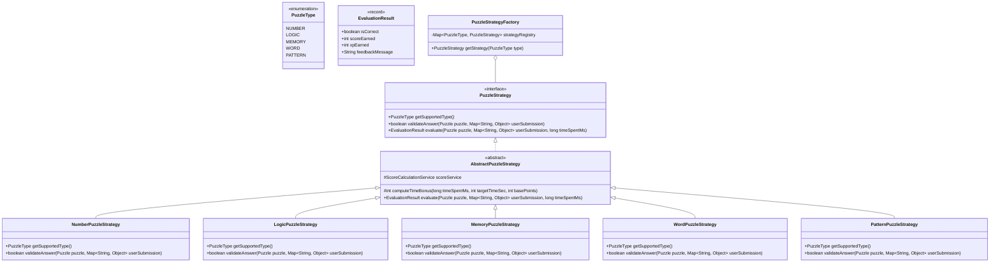

### 4.2 Why This Structure Was Chosen
- **Interface (`PuzzleStrategy`):** Defines the strict contract for puzzle processing without constraining internal mechanics.
- **Abstract Base Class (`AbstractPuzzleStrategy`):** Eliminates duplicate boilerplate logic (common time-bonus calculations, payload null-checks, logging).
- **Inheritance vs. Composition:**
  - *Inheritance* is used selectively between `AbstractPuzzleStrategy` and concrete strategies to share standardized evaluation scaffolding.
  - *Composition* is preferred for supporting services: strategies receive helper beans (`ScoreCalculationService`, `ObjectMapper`) via constructor dependency injection.
- **Polymorphism:** `AttemptService` evaluates attempts uniformly via `strategy.evaluate(...)` without knowing which specific category is executing.

---

## 5. Puzzle Strategy Architecture

### 5.1 The Strategy Pipeline
When a user submits an attempt, the application resolves and invokes the appropriate strategy at runtime:

```
[HTTP Request with Puzzle ID & Answer Payload]
                     │
                     ▼
             [AttemptController]
                     │
                     ▼
              [AttemptService]
                     │
  1. Retrieve Puzzle from Database (includes PuzzleType)
                     │
                     ▼
        [PuzzleStrategyFactory.get(type)]
                     │
        ┌────────────┴────────────┐
        ▼                         ▼
 [NumberPuzzleStrategy]    [LogicPuzzleStrategy] ...
        │
  2. Parse user answer & solution JSON
  3. Validate equality / sequence correctness
  4. Compute time-adjusted points
                     │
                     ▼
          [EvaluationResult Record]
                     │
                     ▼
           [Return to Client]
```

### 5.2 Adding a New Category (Open/Closed Principle)
To add a 6th category (e.g., `SPATIAL_ROTATION`):
1. Add `SPATIAL_ROTATION` to the `PuzzleType` enum.
2. Create `SpatialRotationPuzzleStrategy` extending `AbstractPuzzleStrategy` and annotate with `@Component`.
3. Implement `validateAnswer(...)` specific to spatial logic.
4. **Zero modifications** are needed in `AttemptController`, `AttemptService`, or existing puzzle strategies. Spring automatically detects the new strategy and injects it into `PuzzleStrategyFactory`.

---

## 6. Adaptive Difficulty Architecture

The Adaptive Difficulty system is decoupled into four discrete operational stages:

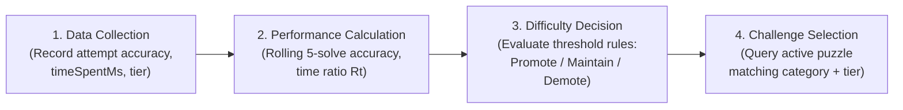

### 6.1 Component Decomposition
1. **Data Collector (`AttemptService`):** Captures atomic metrics upon submission (`isCorrect`, `timeSpentMs`, `puzzleId`, `categoryId`, `difficultyTier`).
2. **Performance Analyzer (`PerformanceAnalyzerService`):**
   - Retrieves recent historical records from `UserCategoryPerformance` and `PuzzleAttempt`.
   - Computes rolling metrics: moving average accuracy over the last 5 attempts, ratio of response time to target time ($R_t$).
3. **Difficulty Decision Engine (`AdaptiveDifficultyEngine`):**
   - Applies state-transition rules:
     - $\ge 3$ consecutive fast correct solves $\rightarrow$ Increase tier (capped at 5).
     - $\ge 2$ consecutive failures OR rolling accuracy $< 40\%$ $\rightarrow$ Decrease tier (floored at 1).
     - Otherwise $\rightarrow$ Maintain current tier.
   - Updates `UserCategoryPerformance` record atomically.
4. **Challenge Selector (`PuzzleSelectionService`):**
   - Accepts `(userId, categoryId)`.
   - Reads current adjusted tier for that category.
   - Selects a puzzle from the catalog matching `(categoryId, currentTier)` that the user has not solved recently.

---

## 7. Scoring Architecture

The scoring calculation separates base difficulty value, performance adjustments, streak multipliers, and long-term experience point (XP) yields:

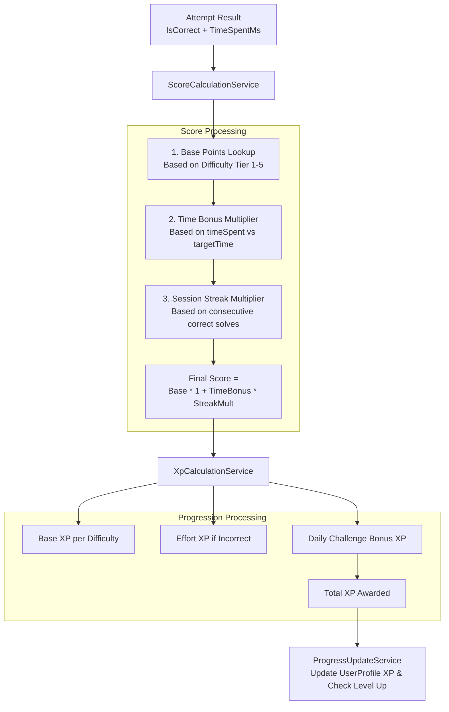

### Component Decoupling
- `ScoreCalculationService`: Pure calculation bean that returns a `ScoreBreakdown` record (base score, time bonus, streak multiplier, total points).
- `XpCalculationService`: Determines progression reward independent of game points.
- `ProgressUpdateService`: Applies points to user profile, compares against level threshold formula ($100 \times L^2 - 100 \times L$), and fires level-up events if a threshold is crossed.

---

## 8. Logical Database Architecture

### 8.1 Logical Entity Specifications

#### 1. `users`
- **PK:** `id` (BIGINT, Auto-Increment)
- **Fields:** `username` (VARCHAR(30), NOT NULL), `email` (VARCHAR(100), NOT NULL), `password_hash` (VARCHAR(255), NOT NULL), `role` (VARCHAR(20), NOT NULL), `is_active` (BOOLEAN, DEFAULT TRUE), `created_at` (DATETIME, NOT NULL), `updated_at` (DATETIME, NOT NULL).
- **Constraints:** UNIQUE(`username`), UNIQUE(`email`).
- **Indexes:** `idx_users_email`, `idx_users_username`.

#### 2. `user_profiles`
- **PK:** `id` (BIGINT, Auto-Increment)
- **Fields:** `user_id` (BIGINT, NOT NULL, FK to `users.id`), `display_name` (VARCHAR(50)), `total_xp` (BIGINT, DEFAULT 0), `current_level` (INT, DEFAULT 1), `current_streak` (INT, DEFAULT 0), `longest_streak` (INT, DEFAULT 0), `last_active_date` (DATE), `created_at` (DATETIME), `updated_at` (DATETIME).
- **Constraints:** UNIQUE(`user_id`), FOREIGN KEY (`user_id`) REFERENCES `users`(`id`) ON DELETE CASCADE.
- **Indexes:** `idx_profiles_user_id`.

#### 3. `categories`
- **PK:** `id` (BIGINT, Auto-Increment)
- **Fields:** `code` (VARCHAR(20), NOT NULL), `display_name` (VARCHAR(50), NOT NULL), `description` (TEXT), `icon_name` (VARCHAR(50)), `is_active` (BOOLEAN, DEFAULT TRUE).
- **Constraints:** UNIQUE(`code`).
- **Indexes:** `idx_categories_code`.

#### 4. `puzzles`
- **PK:** `id` (BIGINT, Auto-Increment)
- **Fields:** `category_id` (BIGINT, NOT NULL, FK to `categories.id`), `difficulty_tier` (INT, NOT NULL), `title` (VARCHAR(100), NOT NULL), `instruction` (TEXT, NOT NULL), `target_time_seconds` (INT, NOT NULL), `base_points` (INT, NOT NULL), `puzzle_data_json` (JSON / TEXT, NOT NULL), `solution_data_json` (JSON / TEXT, NOT NULL), `is_active` (BOOLEAN, DEFAULT TRUE), `created_at` (DATETIME).
- **Constraints:** CHECK (`difficulty_tier` BETWEEN 1 AND 5), FOREIGN KEY (`category_id`) REFERENCES `categories`(`id`).
- **Indexes:** `idx_puzzles_category_tier` (`category_id`, `difficulty_tier`, `is_active`).

#### 5. `puzzle_attempts`
- **PK:** `id` (BIGINT, Auto-Increment)
- **Fields:** `user_id` (BIGINT, NOT NULL, FK to `users.id`), `puzzle_id` (BIGINT, NOT NULL, FK to `puzzles.id`), `is_correct` (BOOLEAN, NOT NULL), `time_spent_ms` (BIGINT, NOT NULL), `score_earned` (INT, NOT NULL), `xp_earned` (INT, NOT NULL), `user_submission_json` (JSON / TEXT), `attempted_at` (DATETIME, NOT NULL).
- **Constraints:** FOREIGN KEY (`user_id`) REFERENCES `users`(`id`), FOREIGN KEY (`puzzle_id`) REFERENCES `puzzles`(`id`).
- **Indexes:** `idx_attempts_user_puzzle` (`user_id`, `attempted_at`), `idx_attempts_user_category` (`user_id`, `puzzle_id`).

#### 6. `user_category_performance`
- **PK:** `id` (BIGINT, Auto-Increment)
- **Fields:** `user_id` (BIGINT, NOT NULL, FK to `users.id`), `category_id` (BIGINT, NOT NULL, FK to `categories.id`), `current_tier` (INT, NOT NULL, DEFAULT 1), `consecutive_correct` (INT, DEFAULT 0), `consecutive_failures` (INT, DEFAULT 0), `total_attempts` (INT, DEFAULT 0), `total_correct` (INT, DEFAULT 0), `average_time_ms` (BIGINT, DEFAULT 0), `updated_at` (DATETIME).
- **Constraints:** UNIQUE(`user_id`, `category_id`), CHECK (`current_tier` BETWEEN 1 AND 5).
- **Indexes:** `idx_perf_user_category` (`user_id`, `category_id`).

#### 7. `achievements`
- **PK:** `id` (BIGINT, Auto-Increment)
- **Fields:** `code` (VARCHAR(50), NOT NULL), `title` (VARCHAR(100), NOT NULL), `description` (VARCHAR(255), NOT NULL), `badge_icon` (VARCHAR(100)), `xp_reward` (INT, NOT NULL), `criteria_type` (VARCHAR(50), NOT NULL), `criteria_threshold` (INT, NOT NULL).
- **Constraints:** UNIQUE(`code`).
- **Indexes:** `idx_achievements_code`.

#### 8. `user_achievements`
- **PK:** `id` (BIGINT, Auto-Increment)
- **Fields:** `user_id` (BIGINT, NOT NULL, FK to `users.id`), `achievement_id` (BIGINT, NOT NULL, FK to `achievements.id`), `unlocked_at` (DATETIME, NOT NULL).
- **Constraints:** UNIQUE(`user_id`, `achievement_id`), FOREIGN KEY (`user_id`) REFERENCES `users`(`id`), FOREIGN KEY (`achievement_id`) REFERENCES `achievements`(`id`).
- **Indexes:** `idx_user_achievements_user` (`user_id`).

#### 9. `daily_challenges`
- **PK:** `id` (BIGINT, Auto-Increment)
- **Fields:** `challenge_date` (DATE, NOT NULL), `puzzle_id` (BIGINT, NOT NULL, FK to `puzzles.id`), `bonus_xp` (INT, NOT NULL, DEFAULT 50), `created_at` (DATETIME).
- **Constraints:** UNIQUE(`challenge_date`), FOREIGN KEY (`puzzle_id`) REFERENCES `puzzles`(`id`).
- **Indexes:** `idx_daily_challenges_date` (`challenge_date`).

---

## 9. Entity Relationship Diagram

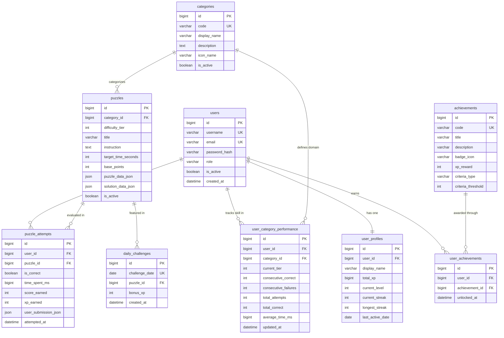

---

## 10. REST API Architecture Blueprint

All endpoints reside under `/api/v1/`.

| Group | Method | Endpoint | Auth | Role | Request DTO | Response DTO | Main Responsibility |
| :--- | :--- | :--- | :---: | :---: | :--- | :--- | :--- |
| **Auth** | `POST` | `/api/v1/auth/register` | No | Any | `RegisterRequest` | `AuthResponse` | Register user & initialize profile |
| **Auth** | `POST` | `/api/v1/auth/login` | No | Any | `LoginRequest` | `AuthResponse` | Authenticate credentials & issue JWT |
| **Auth** | `POST` | `/api/v1/auth/refresh` | Yes | User | `RefreshTokenRequest` | `AuthResponse` | Refresh active JWT token |
| **Users** | `GET` | `/api/v1/users/me` | Yes | User | None | `UserProfileResponse` | Get current user's profile & progress |
| **Users** | `PUT` | `/api/v1/users/me` | Yes | User | `UpdateProfileRequest` | `UserProfileResponse` | Update user display preferences |
| **Puzzles** | `GET` | `/api/v1/puzzles/categories` | Yes | User | None | `List<CategoryResponse>` | Fetch active cognitive categories |
| **Puzzles** | `GET` | `/api/v1/puzzles/next?categoryId={id}` | Yes | User | None | `PuzzlePayloadResponse` | Fetch adaptive puzzle matching tier |
| **Puzzles** | `GET` | `/api/v1/puzzles/{id}` | Yes | User | None | `PuzzlePayloadResponse` | Fetch specific puzzle metadata |
| **Attempts**| `POST` | `/api/v1/attempts` | Yes | User | `SubmitAttemptRequest` | `AttemptResultResponse`| Submit answer & execute full evaluation |
| **Daily** | `GET` | `/api/v1/daily-challenge/today` | Yes | User | None | `DailyChallengeResponse`| Get today's scheduled challenge |
| **Progress**| `GET` | `/api/v1/progress/summary` | Yes | User | None | `ProgressSummaryResponse`| Get overall level, XP, and streak info |
| **Progress**| `GET` | `/api/v1/progress/achievements` | Yes | User | None | `List<AchievementResponse>`| Get all achievements with unlock status |
| **Analytics**| `GET` | `/api/v1/analytics/radar` | Yes | User | None | `RadarChartResponse` | Category skill ratings for radar chart |
| **Analytics**| `GET` | `/api/v1/analytics/history` | Yes | User | None | `HistoryAnalyticsResponse` | 30-day solve count & accuracy trends |
| **Admin** | `POST` | `/api/v1/admin/puzzles` | Yes | Admin | `CreatePuzzleRequest` | `PuzzleAdminResponse` | Create new puzzle with solution |
| **Admin** | `PUT` | `/api/v1/admin/puzzles/{id}` | Yes | Admin | `UpdatePuzzleRequest` | `PuzzleAdminResponse` | Edit puzzle parameters |
| **Admin** | `PATCH`| `/api/v1/admin/puzzles/{id}/status` | Yes | Admin | `StatusToggleRequest` | `PuzzleAdminResponse` | Activate/Deactivate puzzle |
| **Admin** | `GET` | `/api/v1/admin/stats` | Yes | Admin | None | `AdminStatsResponse` | System-wide performance overview |

---

## 11. Authentication & Security Architecture

### 11.1 Spring Security Authentication Lifecycle
MindMaze uses standard Spring Security filters configured for stateless session management (`SessionCreationPolicy.STATELESS`).

```
[Login Request: username/password]
              │
              ▼
    [AuthController.login()]
              │
              ▼
   [AuthenticationManager]
              │
              ▼
  [DaoAuthenticationProvider]
              │
      ┌───────┴───────┐
      ▼               ▼
[UserDetailsService]  [PasswordEncoder.matches()]
      │               │ (BCrypt hash comparison)
      ▼               ▼
   [Authentication Token Generated]
              │
              ▼
      [JwtTokenProvider]
              │ (Sign JWT with HMAC-SHA256)
              ▼
 [Return AuthResponse with JWT to Client]
```

### 11.2 Authenticated Request Verification
```
[Client Request with "Authorization: Bearer <token>"]
                         │
                         ▼
             [JwtAuthenticationFilter]
                         │
   1. Extract token from Header
   2. Validate signature & expiration via JwtTokenProvider
   3. Extract username and roles
                         │
                         ▼
  [Create UsernamePasswordAuthenticationToken]
                         │
                         ▼
        [SecurityContextHolder.getContext()
           .setAuthentication(auth)]
                         │
                         ▼
             [Next Filter / Dispatcher]
                         │
                         ▼
              [@RestController Method]
```

---

## 12. Centralized Exception Architecture

### 12.1 Standard Error Response Format
All errors return an RFC 7807 compliant Problem Detail payload wrapped in a consistent structure:

```json
{
  "timestamp": "2026-09-23T12:34:56.789Z",
  "status": 400,
  "error": "Bad Request",
  "errorCode": "INVALID_ATTEMPT_SUBMISSION",
  "message": "Time spent must be at least 500 milliseconds.",
  "path": "/api/v1/attempts",
  "validationErrors": [
    {
      "field": "timeSpentMs",
      "rejectedValue": 120,
      "message": "Must be greater than or equal to 500"
    }
  ]
}
```

### 12.2 Exception Classification Matrix

| Exception Class | HTTP Status | Error Code | Triggers |
| :--- | :---: | :--- | :--- |
| `BadCredentialsException` | `401 Unauthorized` | `INVALID_CREDENTIALS` | Invalid username or password at login |
| `JwtException` / `ExpiredJwtException` | `401 Unauthorized` | `TOKEN_EXPIRED` | Token expired or invalid signature |
| `AccessDeniedException` | `403 Forbidden` | `ACCESS_DENIED` | Non-admin accessing admin endpoints |
| `ResourceNotFoundException` | `404 Not Found` | `RESOURCE_NOT_FOUND` | Puzzle or user ID does not exist |
| `DuplicateResourceException` | `409 Conflict` | `DUPLICATE_RESOURCE` | Username or email already registered |
| `DailyChallengeAlreadyCompletedException` | `409 Conflict` | `DAILY_CHALLENGE_COMPLETED` | Attempting today's challenge twice |
| `InvalidAttemptException` | `400 Bad Request` | `INVALID_ATTEMPT` | Attempting an inactive puzzle or invalid payload |
| `MethodArgumentNotValidException` | `400 Bad Request` | `VALIDATION_FAILED` | Bean validation failure (`@NotBlank`, etc.) |
| `Exception` (catch-all) | `500 Internal Server`| `INTERNAL_SERVER_ERROR`| Uncaught system failure; stack trace logged |

---

## 13. Transaction Boundaries & Data Integrity

### 13.1 Critical Transaction: Puzzle Attempt Submission
The attempt submission is the most critical workflow in MindMaze. It spans multiple tables and calculations:

```
@Transactional(isolation = Isolation.READ_COMMITTED)
public AttemptResultResponse submitAttempt(Long userId, SubmitAttemptRequest request) {
    1. Lock & fetch Puzzle (read-only verification)
    2. Validate submission via PuzzleStrategy
    3. Calculate score & XP (in-memory services)
    4. Save PuzzleAttempt record
    5. Update UserCategoryPerformance (increment attempts, correct count, adjust tier)
    6. Update UserProfile (increment totalXp, evaluate level-up)
    7. Update StreakService (evaluate calendar date boundary)
    8. Check and unlock eligible Achievements
    9. Return composite AttemptResultResponse
}
```

### 13.2 Consistency Safeguards
- **Atomicity (`@Transactional`):** If achievement evaluation fails or database connection drops during profile update, the entire attempt rollback occurs, preventing inconsistent XP or duplicate streak credit.
- **Isolation Level:** `READ_COMMITTED` avoids dirty reads while maintaining high throughput.
- **Idempotency Guard:** Mobile disables the submit button on initial click; backend rejects subsequent identical attempts within a 2-second window for the same user and puzzle.

---

## 14. Flutter Mobile Architecture

### 14.1 Directory & Layer Organization
The Flutter application follows a Feature-First modular structure:

```
lib/
├── core/                        # Core application framework
│   ├── network/                 # ApiClient (Dio or http), Interceptors, ApiEndpoints
│   ├── storage/                 # SecureStorageService (JWT token persistence)
│   ├── theme/                   # AppColors, AppTypography, AppTheme
│   ├── constants/               # RouteNames, StorageKeys, AssetPaths
│   └── utils/                   # DateTimeFormatter, SoundEffectsHelper
│
├── features/                    # Encapsulated application features
│   ├── auth/                    # LoginScreen, RegisterScreen, AuthProvider/Cubit
│   ├── home/                    # DashboardScreen, CognitiveRadarWidget, StreakWidget
│   ├── puzzle/                  # Gameplay screens per category:
│   │   ├── screens/             # PuzzlePlayScreen, PuzzleResultDialog
│   │   ├── widgets/             # NumberPadWidget, MemoryGridWidget, WordTileBank
│   │   └── state/               # PuzzleController / Cubit
│   ├── progress/                # ProfileScreen, AchievementsListScreen
│   ├── daily_challenge/         # DailyChallengeScreen, CompletionBadgeWidget
│   └── analytics/               # AnalyticsOverviewScreen, RadarChartWidget
│
├── shared/                      # Reusable UI widgets
│   ├── buttons/                 # PrimaryButton, IconButton
│   ├── dialogs/                 # ConfirmationDialog, LevelUpDialog
│   └── feedback/                # LoadingIndicator, ErrorSnackbar
│
└── main.dart                    # Application entry point, Provider/Bloc bootstrap
```

### 14.2 Component Responsibilities
- **Screens:** Dumb UI views listening to state observables; forward user interactions to State Controllers.
- **State Management (Provider or Bloc):** Handles UI state transitions (Loading, Content, Error, Success).
- **API Services:** Make HTTP calls via `ApiClient`, deserialize JSON into Dart models, and throw domain errors.
- **Navigation:** Declarative routing (`GoRouter` or named routes) guarded by authentication status.

---

## 15. API Communication Architecture

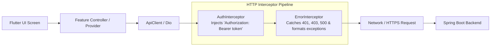

### Protocol Specifications
1. **Base URL Configuration:** Configured via build flavors (`dev`, `staging`, `prod`) using environment configs (`--dart-define=BASE_URL=https://...`).
2. **Secure Token Storage:** Tokens stored exclusively using platform keystore/keychain via `flutter_secure_storage`.
3. **Session Expiry Handling:** When `ErrorInterceptor` catches HTTP `401 Unauthorized`:
   - Attempt refresh if a refresh token is present.
   - If refresh fails or is absent: wipe local secure storage and broadcast `SessionExpiredEvent` to route user to `LoginScreen`.
4. **Offline / Network Drops:** Socket timeout configured to $5000\text{ ms}$; network drops prompt a non-intrusive "No internet connection" banner with retry capability.

---

## 16. Security Architecture & Anti-Tampering

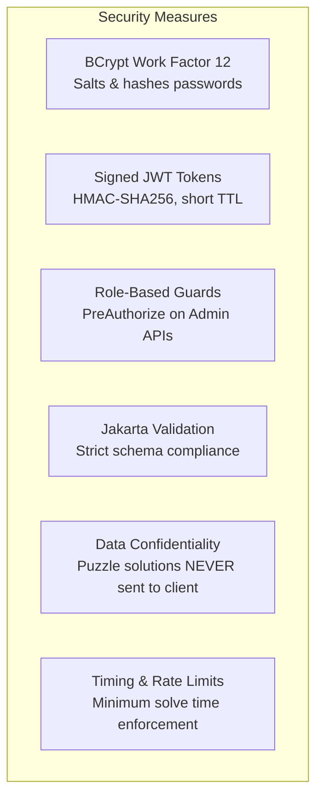

### Security Safeguards
1. **Password Safety:** Stored as one-way BCrypt hashes (work factor 12); plain text is never logged or stored.
2. **Puzzle Solution Protection:**
   - The entity `Puzzle` separates `puzzle_data_json` (visual challenge) from `solution_data_json` (answers).
   - Client response DTOs (`PuzzlePayloadResponse`) map *only* `puzzle_data_json`.
   - **Solution data is never transmitted across the network until after submission evaluation.**
3. **Submission Integrity & Anti-Cheat:**
   - Backend validates that reported `timeSpentMs` is logically consistent ($\ge 500\text{ ms}$; impossible sub-second human solves are rejected).
   - Submissions require valid active puzzle ID; answers cannot be submitted for deactivated puzzles.
4. **Administrative Guarding:** Admin endpoints (`/api/v1/admin/**`) are protected by Spring Security `@PreAuthorize("hasRole('ADMIN')")`.

---

## 17. System Data Flow Diagrams

### 17.1 User Registration Flow
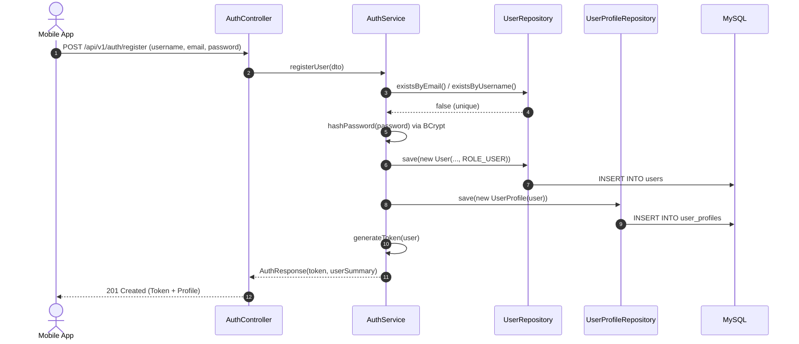

### 17.2 User Login Flow
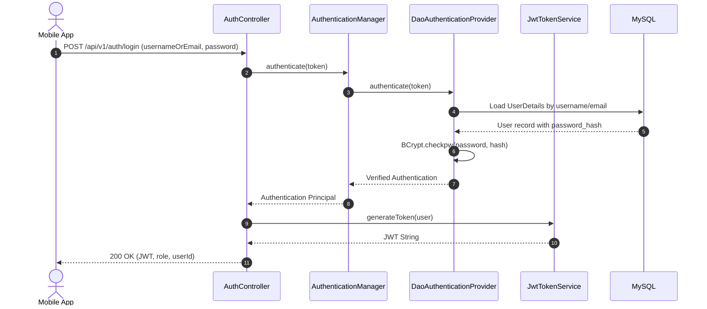

### 17.3 Start Challenge (Adaptive Selection) Flow
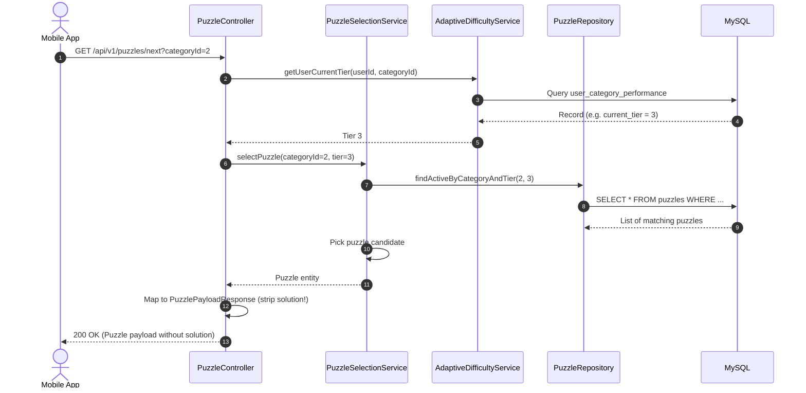

### 17.4 Submit Attempt & Evaluation Flow
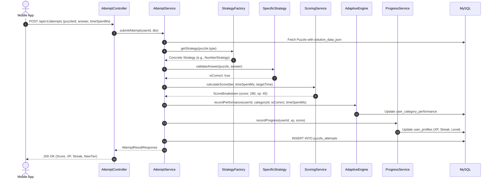

### 17.5 Daily Challenge Flow
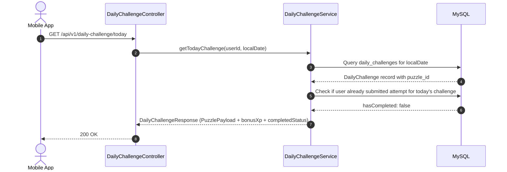

---

## 18. Technology & Dependency Plan

### 18.1 Spring Boot Dependencies (`pom.xml`)

| Dependency Name | Artifact ID | Purpose / Justification |
| :--- | :--- | :--- |
| **Spring Web** | `spring-boot-starter-web` | Exposes REST APIs via Spring MVC, embedded Tomcat server, JSON serialization via Jackson. |
| **Spring Data JPA** | `spring-boot-starter-data-jpa` | Relational data persistence using Hibernate ORM, repositories, `@Transactional` management. |
| **Spring Security** | `spring-boot-starter-security` | Role-based authorization, security filter chain, BCrypt password hashing. |
| **Validation** | `spring-boot-starter-validation` | Declarative request payload validation using Hibernate Validator (`@NotNull`, `@Size`, `@Email`). |
| **MySQL Connector** | `mysql-connector-j` | JDBC driver for communication with MySQL 8.0 database. |
| **JJWT (Java JWT)** | `jjwt-api`, `jjwt-impl`, `jjwt-jackson` | Clean, robust generation and parsing of HMAC-SHA256 signed JSON Web Tokens. |
| **Lombok** | `lombok` | Reduces repetitive Java boilerplate (getters, setters, constructors, loggers) while keeping domain classes clean. |
| **Spring Boot Test** | `spring-boot-starter-test` | Comprehensive testing foundation including JUnit 5, Mockito, AssertJ, and Spring MockMvc. |
| **H2 Database (Test Only)**| `h2` | In-memory database used exclusively for fast, self-contained unit and integration testing. |

---

## 19. Development Environment & Tooling Specifications

| Tool / Runtime | Specified Version | Compatibility Verification |
| :--- | :--- | :--- |
| **Java Development Kit (JDK)** | **Java 17 LTS** (or 21 LTS) | Modern Long-Term Support version fully compatible with Spring Boot 3.x and records. |
| **Spring Boot** | **3.2.x** (or latest stable 3.x) | Native Jakarta EE namespace, robust security filter chain, modern RFC 7807 support. |
| **Apache Maven** | **3.9.x** | Standard enterprise build automation tool for Java projects. |
| **MySQL Server** | **8.0.x** | Enterprise standard relational database with native JSON column support and robust indexing. |
| **Flutter SDK** | **3.19.x** (or latest stable 3.x) | Modern Dart 3.x, Material 3 design system, responsive layout widgets. |
| **Dart SDK** | **3.3.x** | Sound null-safety, records, and pattern matching. |

*Note: All versions are pinned to verified, mutually compatible production LTS baselines.*

---

## 20. Architecture Decision Records (ADR)

### ADR-1: Adoption of Modular Monolith over Microservices
- **Decision:** Build MindMaze as a single Spring Boot application divided into domain modules.
- **Context:** Student project demonstrating strong Java backend design.
- **Consequences:** Avoids distributed network latency, container orchestration overhead, and multi-repo maintenance. Simplifies debugging, local setup, and technical interview defense.

### ADR-2: Selection of Java Spring Boot for Backend Logic
- **Decision:** Use Java 17+ and Spring Boot 3.x for all business processing.
- **Context:** The application requires substantial algorithmic logic (scoring, tier adjustments, streak handling).
- **Consequences:** Provides type safety, rich ecosystem, production-grade dependency injection, robust transaction boundaries, and excellent interview presentation value.

### ADR-3: Utilization of Strategy Pattern for Puzzle Engine
- **Decision:** Model puzzle evaluation via `PuzzleStrategy` implementations managed by `PuzzleStrategyFactory`.
- **Context:** Multiple puzzle categories exist, each with unique data formats and validation rules.
- **Consequences:** Satisfies the Open/Closed Principle. New puzzle categories can be added without altering existing code or changing controllers.

### ADR-4: Stateless JWT Authentication over Server-Side Sessions
- **Decision:** Issue signed JWT tokens upon login; validate via custom `JwtAuthenticationFilter`.
- **Context:** Mobile clients communicate intermittently across cellular networks.
- **Consequences:** Eliminates server-side session memory consumption, simplifies horizontal scaling, and aligns with standard REST architectural conventions.

### ADR-5: Seeded Database Puzzle Templates for MVP
- **Decision:** Seed predefined puzzle templates in MySQL for the initial MVP; defer procedural generation to Phase 5.
- **Context:** Ensures immediate, reliable, handcrafted puzzle quality across all 5 cognitive categories without needing complex algorithmic generators on day one.
- **Consequences:** Reduces early development risk while providing immediate test cases for the adaptive difficulty engine.

### ADR-6: Flutter for Cross-Platform Mobile Client
- **Decision:** Build the mobile client in Flutter/Dart.
- **Context:** Cross-platform requirement with high-performance 60fps animations for timers and cognitive grids.
- **Consequences:** Single codebase for Android and iOS with rich declarative UI components and rapid iteration.

---

## 21. Implementation Readiness Checklist

- [x] **Backend Package Architecture:** Clean modular package layout designed under `com.mindmaze`.
- [x] **Layer Responsibilities:** Strict MUST and MUST NOT boundaries defined for all architectural tiers.
- [x] **Core Java Design:** Abstractions, interfaces, and inheritance vs. composition trade-offs documented.
- [x] **Puzzle Strategy Architecture:** Polymorphic evaluation pipeline and extensibility design verified.
- [x] **Adaptive Difficulty Architecture:** 4-stage pipeline (collection, calculation, decision, selection) detailed.
- [x] **Scoring Architecture:** Clear separation of base score, time bonus, multipliers, and XP progression.
- [x] **Logical Database Architecture:** 9 relational entities defined with PKs, FKs, constraints, and indexes.
- [x] **Entity Relationship Diagram:** Mermaid ER diagram mapping all associations including join entities.
- [x] **REST API Blueprint:** Complete endpoint inventory with HTTP methods, paths, DTOs, and roles.
- [x] **Authentication Architecture:** Spring Security lifecycle and JWT filter pipeline designed.
- [x] **Exception Architecture:** RFC 7807 compliant error format and exception classification defined.
- [x] **Transaction Boundaries:** Transactional requirements and atomicity protections mapped.
- [x] **Flutter Architecture:** Feature-First directory structure, state management, and navigation outlined.
- [x] **API Communication Architecture:** Interceptors, token storage, and failure handling specified.
- [x] **Security Architecture:** Password hashing, solution concealment, and anti-tampering measures detailed.
- [x] **Data Flow Diagrams:** 5 complete sequence diagrams mapped for core workflows.
- [x] **Technology Plan:** Necessary Maven dependencies listed and justified.
- [x] **Development Environment:** Compatible LTS versions defined for Java, Spring Boot, MySQL, and Flutter.
- [x] **Architecture Decision Records:** 6 core ADRs documented.

---

## Review & Sign-Off Section

### Confirmed Architecture Decisions
1. **Architecture:** Modular Monolith in Spring Boot 3.x + Flutter + MySQL 8.0.
2. **Persistence:** Spring Data JPA with HikariCP connection pooling.
3. **Security:** Stateless Spring Security with BCrypt password hashing and HMAC-SHA256 JWT tokens.
4. **Design Patterns:** Strategy Pattern for puzzle validation; Factory Pattern for runtime strategy dispatch; Repository Pattern for data access; DTO Pattern for network boundary encapsulation.
5. **Business Logic Location:** All calculations (scoring, adaptive tiers, XP, streaks) reside strictly in Java Services, never in database stored procedures or client-side code.
6. **Solution Concealment:** Puzzle solution data is strictly concealed from mobile clients until evaluation is completed on the server.

### Proposed Decisions Requiring Approval
1. Use of **Lombok** (`@Getter`, `@Setter`, `@RequiredArgsConstructor`) to reduce Java boilerplate.
2. Default JWT access token expiration duration set to **24 hours** (86,400 seconds) for student testing convenience before adding refresh token rotation.
3. Use of **H2 in-memory database** strictly scoped for unit and integration testing.

### Open Technical Questions
- *Q1:* Would you prefer Jackson JSON column mapping directly into Java Records for `puzzleDataJson` or generic `Map<String, Object>` parsing within each strategy? *(Recommended: Java Records per puzzle type for strict type safety).*

---

*Phase 0.3 Technical Architecture & System Blueprint is complete. Ready for review.*
